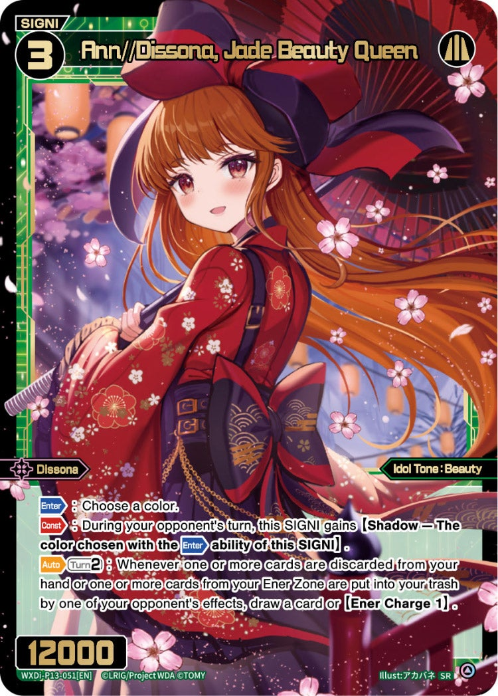

# Ann//Dissona, Jade Beauty Queen

## Thông tin lá

| Trường | Giá trị |
| --- | --- |
| Mã in | WXDi-P13-051[EN] |
| Set | WXDi-P13[EN] |
| Số thứ tự | 051 |
| Loại thẻ | SIGNI |
| Vị trí | Main Deck |
| Số bản | — (set booster, không áp dụng) |
| Màu | Xanh lá |
| Độ hiếm | SR,SRP |
| Minh họa | アカバネ |
| Level | 3 |
| Limit | — |
| Power | 12000 |
| LRIG type / Class | Idol Tone：Beauty |
| Team / Master | — |
| Cost | — |
| Grow cost | — |
| Use timing | — |
| Life Burst | Không |

## Card text chính thức

[Enter]: Choose a color.
[Constant]: During your opponent's turn, this SIGNI gains 【Shadow — The color chosen with the [Enter] ability of this SIGNI】.
[Auto] {2/Turn}: Whenever one or more cards are discarded from your hand or one or more cards from your Ener Zone are put into your trash by one of your opponent's effects, draw a card or 【Ener Charge 1】.

## Power text / Life Burst

—

## Ghi chú minh họa
Artist: アカバネ. Ảnh SR được tải từ Card List tiếng Anh.

## FAQ chính thức

**Q. May I choose a colorless by the [Enter] ability?**
A. No. Colorless does not have a color and cannot be chosen by the effect of choosing colors

**Q. I discarded two cards from my hand by my opponent's "discard two cards from your opponent's hand" effect. How many times does the [Auto] ability trigger?**
A. it is triggered once. The condition is "Whenever one or more cards are discarded from your hand", so even if multiple cards are discarded, if this is done as a single action with a single effect, it will only trigger once.

## Ảnh biến thể

- [SRP](../images/WXDi-P13-051P-EN.jpg)

## Nguồn
[Card List/FAQ chính thức](https://www.takaratomy.co.jp/products/en.wixoss/card/card.html?card_no=WXDi-P13-051%5BEN%5D ) · [Ảnh thẻ](https://www.takaratomy.co.jp/products/en.wixoss/card/thumb/WXDi-P13-051%5BEN%5D.jpg)
