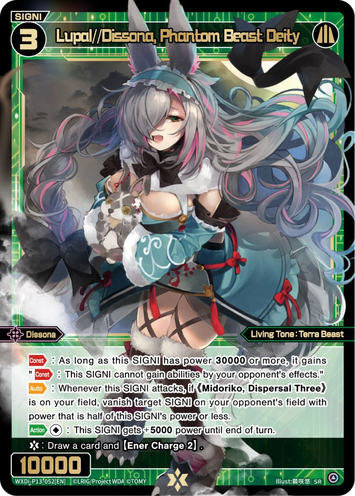

# Lupal//Dissona, Phantom Beast Deity

## Thông tin lá

| Trường | Giá trị |
| --- | --- |
| Mã in | WXDi-P13-052[EN] |
| Set | WXDi-P13[EN] |
| Số thứ tự | 052 |
| Loại thẻ | SIGNI |
| Vị trí | Main Deck |
| Số bản | — (set booster, không áp dụng) |
| Màu | Xanh lá |
| Độ hiếm | SR,SRP |
| Minh họa | 繭咲悠 |
| Level | 3 |
| Limit | — |
| Power | 10000 |
| LRIG type / Class | Living Tone：Terra Beast |
| Team / Master | — |
| Cost | — |
| Grow cost | — |
| Use timing | — |
| Life Burst | Có |

## Card text chính thức

[Constant]: As long as this SIGNI has power 30000 or more, it gains "[Constant]: This SIGNI cannot gain abilities by your opponent's effects."
[Auto]: Whenever this SIGNI attacks, if 《Midoriko, Dispersal Three》 is on your field, vanish target SIGNI on your opponent's field with power that is half of this SIGNI's power or less.
[Action] {Colorless}: This SIGNI gets +5000 power until end of turn.

## Power text / Life Burst

Draw a card and 【Ener Charge 2】.

## Ghi chú minh họa
Artist: 繭咲悠. Ảnh SR được tải từ Card List tiếng Anh.

## FAQ chính thức

— (không có FAQ riêng cho mã này trên trang FAQ tiếng Anh.)

## Ảnh biến thể

- [SRP](../images/WXDi-P13-052P-EN.jpg)

## Nguồn
[Card List/FAQ chính thức](https://www.takaratomy.co.jp/products/en.wixoss/card/card.html?card_no=WXDi-P13-052%5BEN%5D ) · [Ảnh thẻ](https://www.takaratomy.co.jp/products/en.wixoss/card/thumb/WXDi-P13-052%5BEN%5D.jpg)
