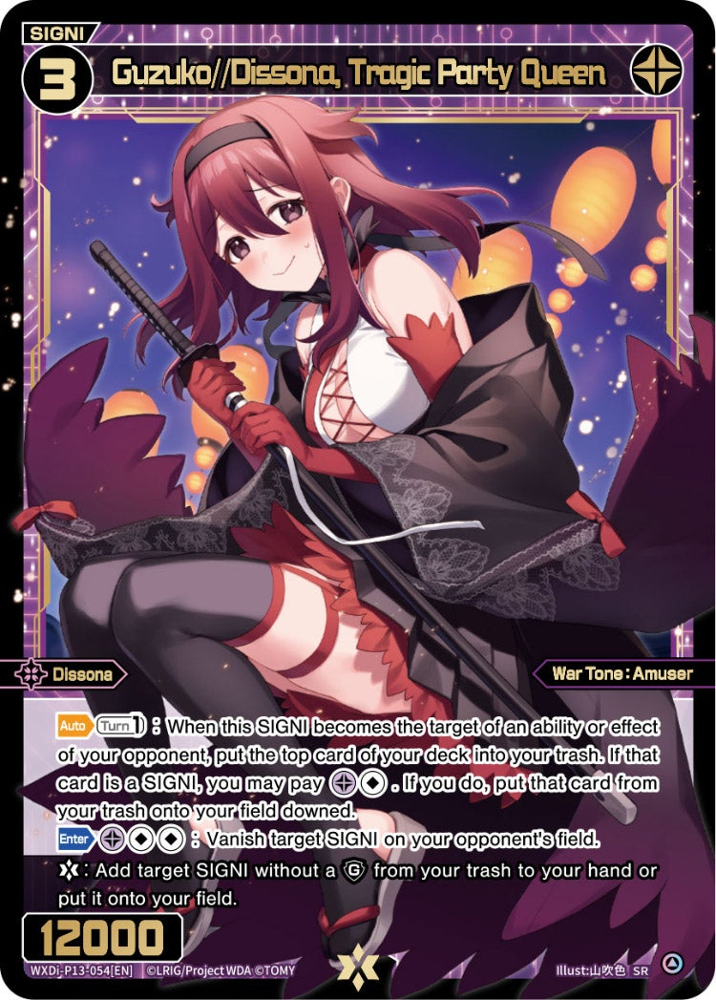

# Guzuko//Dissona, Tragic Party Queen

## Thông tin lá

| Trường | Giá trị |
| --- | --- |
| Mã in | WXDi-P13-054[EN] |
| Set | WXDi-P13[EN] |
| Số thứ tự | 054 |
| Loại thẻ | SIGNI |
| Vị trí | Main Deck |
| Số bản | — (set booster, không áp dụng) |
| Màu | Đen |
| Độ hiếm | SR,SRP |
| Minh họa | 山吹色 |
| Level | 3 |
| Limit | — |
| Power | 12000 |
| LRIG type / Class | War Tone：Amuser |
| Team / Master | — |
| Cost | — |
| Grow cost | — |
| Use timing | — |
| Life Burst | Có |

## Card text chính thức

[Auto] {1/Turn}: When this SIGNI becomes the target of an ability or effect of your opponent, put the top card of your deck into your trash. If that card is a SIGNI, you may pay {Black} {Colorless}. If you do, put that card from your trash onto your field downed.
[Enter] {Black} {Colorless} {Colorless}: Vanish target SIGNI on your opponent's field.

## Power text / Life Burst

Add target SIGNI without a {Guard Icon} from your trash to your hand or put it onto your field.

## Ghi chú minh họa
Artist: 山吹色. Ảnh SR được tải từ Card List tiếng Anh.

## FAQ chính thức

**Q. What happens to this card's [Auto] ability if this SIGNI becomes the target of a "vanish target SIGNI" effect or a "target SIGNI lose all abilities" effect?**
A. In that case, the ability will trigger when it becomes the target. After that, even if this SIGNI is varnished or loses its abilities by the effect, the ability that is already triggered will still resolve.

## Ảnh biến thể

- [SRP](../images/WXDi-P13-054P-EN.jpg)

## Nguồn
[Card List/FAQ chính thức](https://www.takaratomy.co.jp/products/en.wixoss/card/card.html?card_no=WXDi-P13-054%5BEN%5D ) · [Ảnh thẻ](https://www.takaratomy.co.jp/products/en.wixoss/card/thumb/WXDi-P13-054%5BEN%5D.jpg)
