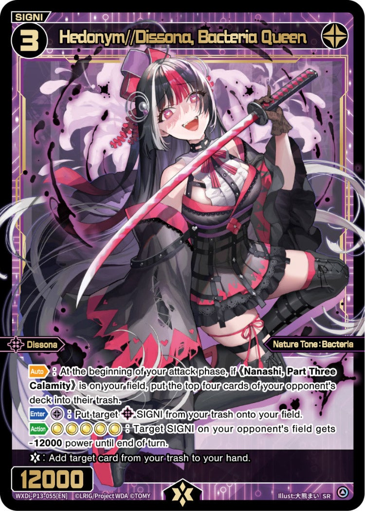

# Hedonym//Dissona, Bacteria Queen

## Thông tin lá

| Trường | Giá trị |
| --- | --- |
| Mã in | WXDi-P13-055[EN] |
| Set | WXDi-P13[EN] |
| Số thứ tự | 055 |
| Loại thẻ | SIGNI |
| Vị trí | Main Deck |
| Số bản | — (set booster, không áp dụng) |
| Màu | Đen |
| Độ hiếm | SR,SRP |
| Minh họa | 大熊まい |
| Level | 3 |
| Limit | — |
| Power | 12000 |
| LRIG type / Class | Nature Tone：Bacteria |
| Team / Master | — |
| Cost | — |
| Grow cost | — |
| Use timing | — |
| Life Burst | Có |

## Card text chính thức

[Auto]: At the beginning of your attack phase, if 《Nanashi, Part Three Calamity》 is on your field, put the top four cards of your opponent's deck into their trash.
[Enter] {Black}: Put target {Dissona Icon} SIGNI from your trash onto your field.
[Action] {Coin Icon} {Coin Icon} {Coin Icon} {Coin Icon} {Coin Icon}: Target SIGNI on your opponent's field gets -12000 power until end of turn.

## Power text / Life Burst

Add target card from your trash to your hand.

## Ghi chú minh họa
Artist: 大熊まい. Ảnh SR được tải từ Card List tiếng Anh.

## FAQ chính thức

— (không có FAQ riêng cho mã này trên trang FAQ tiếng Anh.)

## Ảnh biến thể

- [SRP](../images/WXDi-P13-055P-EN.jpg)

## Nguồn
[Card List/FAQ chính thức](https://www.takaratomy.co.jp/products/en.wixoss/card/card.html?card_no=WXDi-P13-055%5BEN%5D ) · [Ảnh thẻ](https://www.takaratomy.co.jp/products/en.wixoss/card/thumb/WXDi-P13-055%5BEN%5D.jpg)
