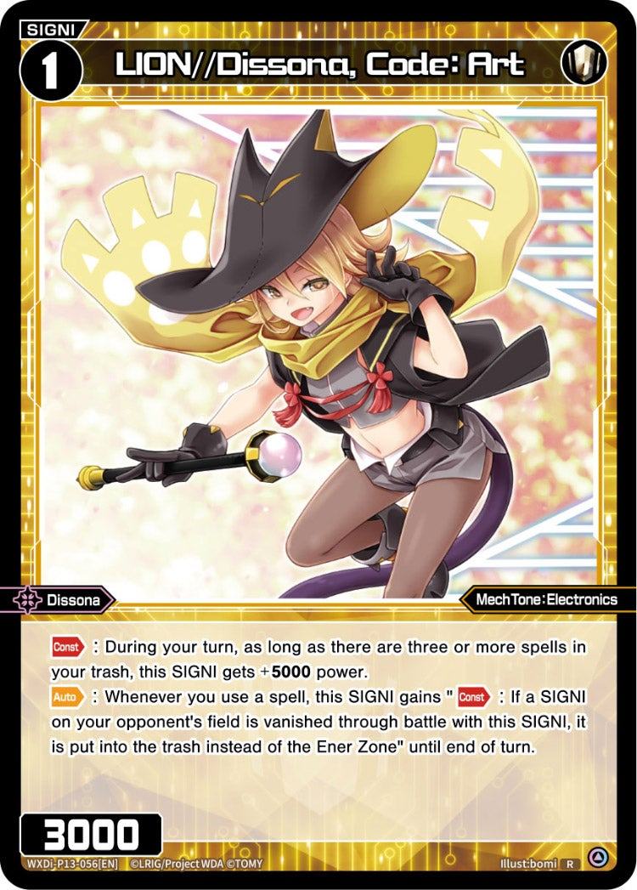

# LION//Dissona, Code: Art

## Thông tin lá

| Trường | Giá trị |
| --- | --- |
| Mã in | WXDi-P13-056[EN] |
| Set | WXDi-P13[EN] |
| Số thứ tự | 056 |
| Loại thẻ | SIGNI |
| Vị trí | Main Deck |
| Số bản | — (set booster, không áp dụng) |
| Màu | Trắng |
| Độ hiếm | R,R(P) |
| Minh họa | bomi |
| Level | 1 |
| Limit | — |
| Power | 3000 |
| LRIG type / Class | Mech Tone：Electronics |
| Team / Master | — |
| Cost | — |
| Grow cost | — |
| Use timing | — |
| Life Burst | Không |

## Card text chính thức

[Constant]: During your turn, as long as there are three or more spells in your trash, this SIGNI gets +5000 power.
[Auto]: Whenever you use a spell, this SIGNI gains "[Constant]: If a SIGNI on your opponent's field is vanished through battle with this SIGNI, it is put into the trash instead of the Ener Zone" until end of turn.

## Power text / Life Burst

—

## Ghi chú minh họa
Artist: bomi. Ảnh R được tải từ Card List tiếng Anh.

## FAQ chính thức

**Q. After the second [Auto] ability resolves, my opponent's SIGNI was vanished by a battle with this SIGNI. If that SIGNI has an [Auto] ability that triggers "When this SIGNI is vanished", does it trigger?**
A. Yes, it is triggered. This effect only replaces the zone where it is placed if it is vanished, but the vanishing itself is valid.

## Ảnh biến thể

- [R(P)](../images/WXDi-P13-056P-EN.jpg)

## Nguồn
[Card List/FAQ chính thức](https://www.takaratomy.co.jp/products/en.wixoss/card/card.html?card_no=WXDi-P13-056%5BEN%5D ) · [Ảnh thẻ](https://www.takaratomy.co.jp/products/en.wixoss/card/thumb/WXDi-P13-056%5BEN%5D.jpg)
