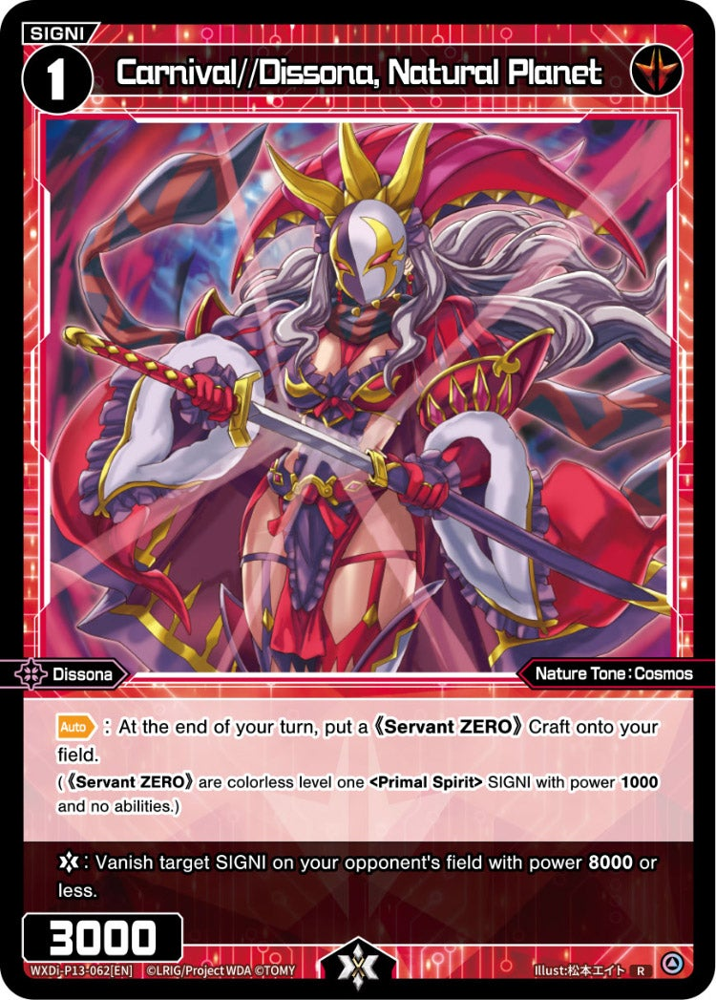

# Carnival//Dissona, Natural Planet

## Thông tin lá

| Trường | Giá trị |
| --- | --- |
| Mã in | WXDi-P13-062[EN] |
| Set | WXDi-P13[EN] |
| Số thứ tự | 062 |
| Loại thẻ | SIGNI |
| Vị trí | Main Deck |
| Số bản | — (set booster, không áp dụng) |
| Màu | Đỏ |
| Độ hiếm | R,R(P) |
| Minh họa | 松本エイト |
| Level | 1 |
| Limit | — |
| Power | 3000 |
| LRIG type / Class | Nature Tone：Cosmos |
| Team / Master | — |
| Cost | — |
| Grow cost | — |
| Use timing | — |
| Life Burst | Có |

## Card text chính thức

[Auto]: At the end of your turn, put a 《Servant ZERO》 Craft onto your field.
(《Servant ZERO》 are colorless level one <Primal Spirit> SIGNI with power 1000 and no abilities.)

## Power text / Life Burst

Vanish target SIGNI on your opponent's field with power 8000 or less.

## Ghi chú minh họa
Artist: 松本エイト. Ảnh R được tải từ Card List tiếng Anh.

## FAQ chính thức

**Q. What happens if the 《Servant ZERO》 Craft is leaves the field?**
A. If a Craft SIGNI leaves the field, it is instead removed from the game.

**Q. May the 《Servant ZERO》 Craft be chosen by an effect that targets a SIGNI or card?**
A. It is a SIGNI, so it can be chosen by effects that target a SIGNI. Craft is not a card, so it cannot be chosen by effects that target a card.

## Ảnh biến thể

- [R(P)](../images/WXDi-P13-062P-EN.jpg)

## Nguồn
[Card List/FAQ chính thức](https://www.takaratomy.co.jp/products/en.wixoss/card/card.html?card_no=WXDi-P13-062%5BEN%5D ) · [Ảnh thẻ](https://www.takaratomy.co.jp/products/en.wixoss/card/thumb/WXDi-P13-062%5BEN%5D.jpg)
