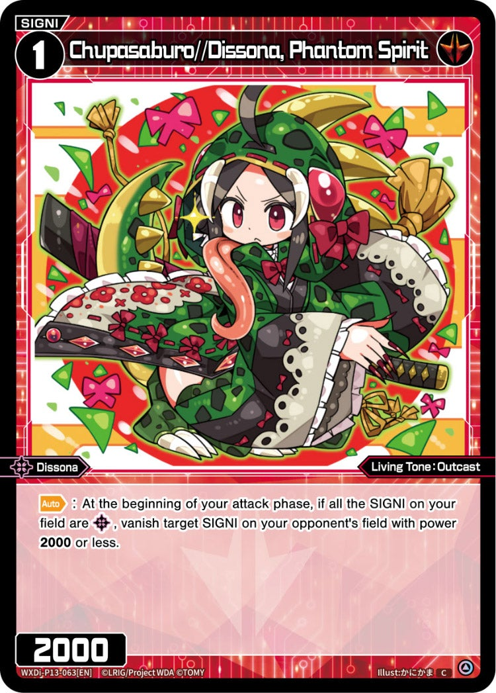

# Chupasaburo//Dissona, Phantom Spirit

## Thông tin lá

| Trường | Giá trị |
| --- | --- |
| Mã in | WXDi-P13-063[EN] |
| Set | WXDi-P13[EN] |
| Số thứ tự | 063 |
| Loại thẻ | SIGNI |
| Vị trí | Main Deck |
| Số bản | — (set booster, không áp dụng) |
| Màu | Đỏ |
| Độ hiếm | C,C(P) |
| Minh họa | かにかま |
| Level | 1 |
| Limit | — |
| Power | 2000 |
| LRIG type / Class | Living Tone：Outcast |
| Team / Master | — |
| Cost | — |
| Grow cost | — |
| Use timing | — |
| Life Burst | Không |

## Card text chính thức

[Auto]: At the beginning of your attack phase, if all the SIGNI on your field are {Dissona Icon}, vanish target SIGNI on your opponent's field with power 2000 or less.

## Power text / Life Burst

—

## Ghi chú minh họa
Artist: かにかま. Ảnh C được tải từ Card List tiếng Anh.

## FAQ chính thức

**Q. If there is only this SIGNI on my field at the beginning of the Attack Phase, does the [Auto] ability trigger?**
A. Yes, it is triggered.

## Ảnh biến thể

- [C(P)](../images/WXDi-P13-063P-EN.jpg)

## Nguồn
[Card List/FAQ chính thức](https://www.takaratomy.co.jp/products/en.wixoss/card/card.html?card_no=WXDi-P13-063%5BEN%5D ) · [Ảnh thẻ](https://www.takaratomy.co.jp/products/en.wixoss/card/thumb/WXDi-P13-063%5BEN%5D.jpg)
