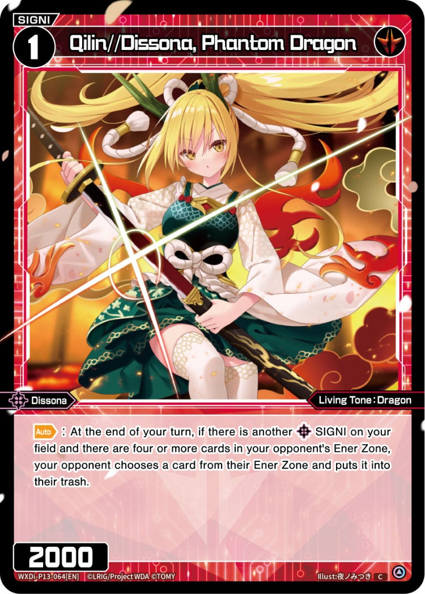

# Qilin//Dissona, Phantom Dragon

## Thông tin lá

| Trường | Giá trị |
| --- | --- |
| Mã in | WXDi-P13-064[EN] |
| Set | WXDi-P13[EN] |
| Số thứ tự | 064 |
| Loại thẻ | SIGNI |
| Vị trí | Main Deck |
| Số bản | — (set booster, không áp dụng) |
| Màu | Đỏ |
| Độ hiếm | C,C(P) |
| Minh họa | 夜ノみつき |
| Level | 1 |
| Limit | — |
| Power | 2000 |
| LRIG type / Class | Living Tone：Dragon |
| Team / Master | — |
| Cost | — |
| Grow cost | — |
| Use timing | — |
| Life Burst | Không |

## Card text chính thức

[Auto]: At the end of your turn, if there is another {Dissona Icon} SIGNI on your field and there are four or more cards in your opponent's Ener Zone, your opponent chooses a card from their Ener Zone and puts it into their trash.

## Power text / Life Burst

—

## Ghi chú minh họa
Artist: 夜ノみつき. Ảnh C được tải từ Card List tiếng Anh.

## FAQ chính thức

**Q. At the end of the turn, I have two 《Qilin//Dissona, Phantom Dragon》 on my field and four cards in my opponent's Ener Zone. What happens to the [Auto] abilities of the two 《Qilin//Dissona, Phantom Dragon》?**
A. Each of the two [Auto] abilities triggers and resolves in turn; the first one resolves, so that your opponent has three cards in their Ener Zone, so nothing happens with the [Auto] ability of the second one.

## Ảnh biến thể

- [C(P)](../images/WXDi-P13-064P-EN.jpg)

## Nguồn
[Card List/FAQ chính thức](https://www.takaratomy.co.jp/products/en.wixoss/card/card.html?card_no=WXDi-P13-064%5BEN%5D ) · [Ảnh thẻ](https://www.takaratomy.co.jp/products/en.wixoss/card/thumb/WXDi-P13-064%5BEN%5D.jpg)
