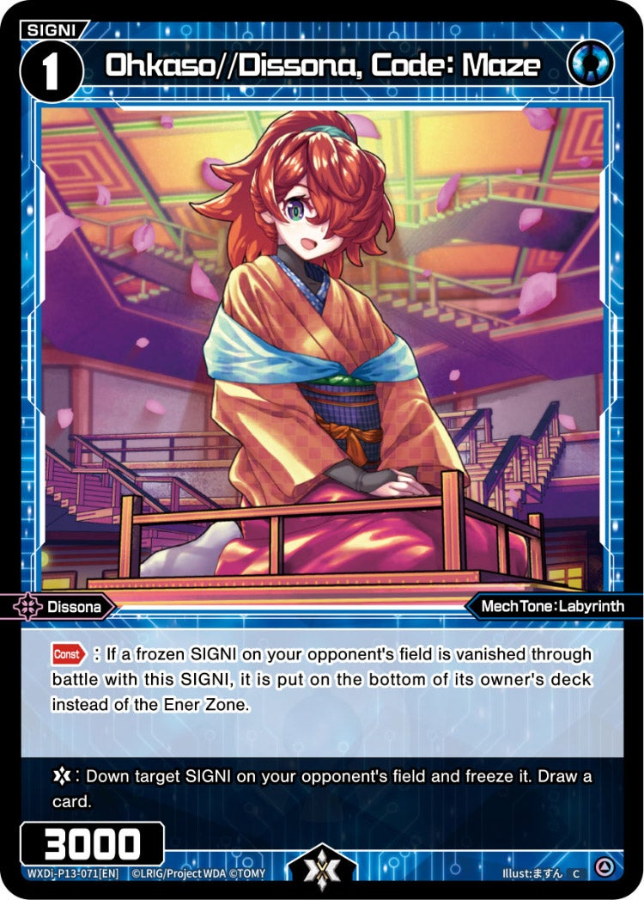

# Ohkaso//Dissona, Code: Maze

## Thông tin lá

| Trường | Giá trị |
| --- | --- |
| Mã in | WXDi-P13-071[EN] |
| Set | WXDi-P13[EN] |
| Số thứ tự | 071 |
| Loại thẻ | SIGNI |
| Vị trí | Main Deck |
| Số bản | — (set booster, không áp dụng) |
| Màu | Xanh dương |
| Độ hiếm | C,C(P) |
| Minh họa | ますん |
| Level | 1 |
| Limit | — |
| Power | 3000 |
| LRIG type / Class | Mech Tone：Labyrinth |
| Team / Master | — |
| Cost | — |
| Grow cost | — |
| Use timing | — |
| Life Burst | Có |

## Card text chính thức

[Constant]: If a frozen SIGNI on your opponent's field is vanished through battle with this SIGNI, it is put on the bottom of its owner's deck instead of the Ener Zone.

## Power text / Life Burst

Down target SIGNI on your opponent's field and freeze it. Draw a card.

## Ghi chú minh họa
Artist: ますん. Ảnh C được tải từ Card List tiếng Anh.

## FAQ chính thức

**Q. My opponent's frozen SIGNI was vanished by a battle with this SIGNI. If that SIGNI has an [Auto] ability that triggers "When this SIGNI is vanished", does it trigger?**
A. Yes, it is triggered. This effect only replaces the zone where it is placed if it is vanished, but the vanishing itself is valid.

## Ảnh biến thể

- [C(P)](../images/WXDi-P13-071P-EN.jpg)

## Nguồn
[Card List/FAQ chính thức](https://www.takaratomy.co.jp/products/en.wixoss/card/card.html?card_no=WXDi-P13-071%5BEN%5D ) · [Ảnh thẻ](https://www.takaratomy.co.jp/products/en.wixoss/card/thumb/WXDi-P13-071%5BEN%5D.jpg)
