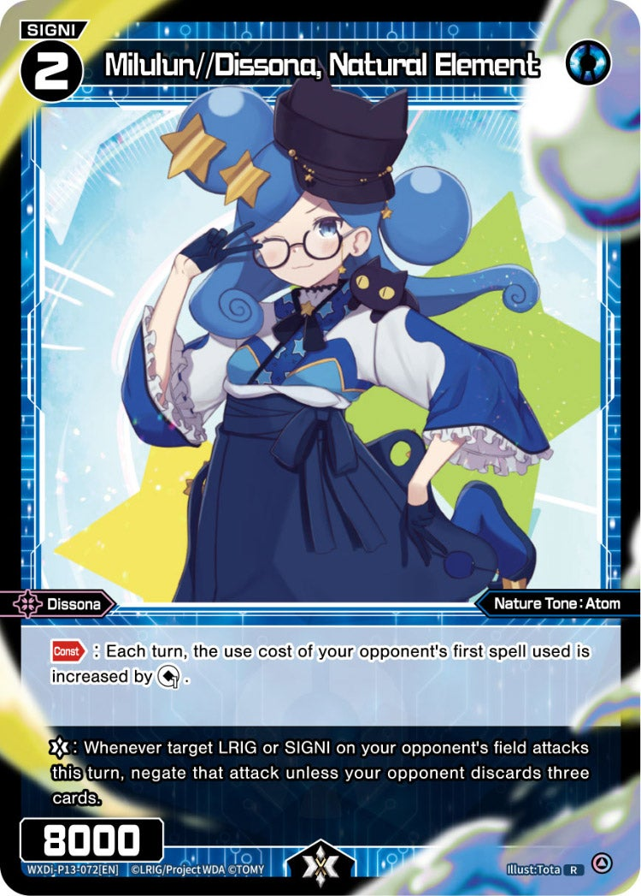

# Milulun//Dissona, Natural Element

## Thông tin lá

| Trường | Giá trị |
| --- | --- |
| Mã in | WXDi-P13-072[EN] |
| Set | WXDi-P13[EN] |
| Số thứ tự | 072 |
| Loại thẻ | SIGNI |
| Vị trí | Main Deck |
| Số bản | — (set booster, không áp dụng) |
| Màu | Xanh dương |
| Độ hiếm | R,R(P) |
| Minh họa | Tota |
| Level | 2 |
| Limit | — |
| Power | 8000 |
| LRIG type / Class | Nature Tone：Atom |
| Team / Master | — |
| Cost | — |
| Grow cost | — |
| Use timing | — |
| Life Burst | Có |

## Card text chính thức

[Constant]: Each turn, the use cost of your opponent's first spell used is increased by {Colorlessx1}.

## Power text / Life Burst

Whenever target LRIG or SIGNI on your opponent's field attacks this turn, negate that attack unless your opponent discards three cards.

## Ghi chú minh họa
Artist: Tota. Ảnh R được tải từ Card List tiếng Anh.

## FAQ chính thức

**Q. If my opponent triggers the Life Burst of spells, does my opponent have to pay {Colorlessx1}?**
A. No, your opponent does not have to pay. Triggered Life Burst is not the use of spells and this [Const] ability has no effect.

## Ảnh biến thể

- [R(P)](../images/WXDi-P13-072P-EN.jpg)

## Nguồn
[Card List/FAQ chính thức](https://www.takaratomy.co.jp/products/en.wixoss/card/card.html?card_no=WXDi-P13-072%5BEN%5D ) · [Ảnh thẻ](https://www.takaratomy.co.jp/products/en.wixoss/card/thumb/WXDi-P13-072%5BEN%5D.jpg)
