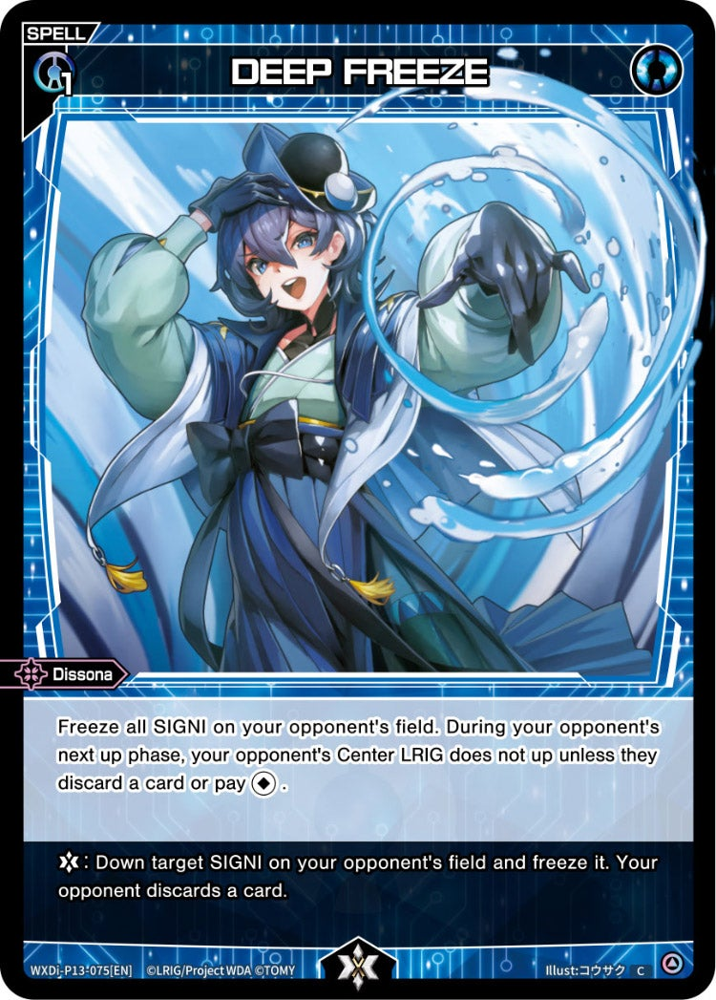

# DEEP FREEZE

## Thông tin lá

| Trường | Giá trị |
| --- | --- |
| Mã in | WXDi-P13-075[EN] |
| Set | WXDi-P13[EN] |
| Số thứ tự | 075 |
| Loại thẻ | SPELL |
| Vị trí | Main Deck |
| Số bản | — (set booster, không áp dụng) |
| Màu | Xanh dương |
| Độ hiếm | C,C(P) |
| Minh họa | コウサク |
| Level | — |
| Limit | — |
| Power | 0 |
| LRIG type / Class | — |
| Team / Master | — |
| Cost | 《U》×１ |
| Grow cost | — |
| Use timing | — |
| Life Burst | Có |

## Card text chính thức

Freeze all SIGNI on your opponent's field. During your opponent's next up phase, your opponent's Center LRIG does not up unless they discard a card or pay {Colorless}.

## Power text / Life Burst

Down target SIGNI on your opponent's field and freeze it. Your opponent discards a card.

## Ghi chú minh họa
Artist: コウサク. Ảnh C được tải từ Card List tiếng Anh.

## FAQ chính thức

**Q. When does my opponent discard a card or pay {Colorless}?**
A. This is in the next UP Phase of your opponent.

**Q. What happens if two copies of this spell are used in the same turn?**
A. A frozen SIGNI will not be frozen any further, but in the next your opponent's Up Phase, your opponent must "discard a card or pay {colorless}" as many times as this spell has been used, or your opponent's center LRIG will not be up.

## Ảnh biến thể

- [C(P)](../images/WXDi-P13-075P-EN.jpg)

## Nguồn
[Card List/FAQ chính thức](https://www.takaratomy.co.jp/products/en.wixoss/card/card.html?card_no=WXDi-P13-075%5BEN%5D ) · [Ảnh thẻ](https://www.takaratomy.co.jp/products/en.wixoss/card/thumb/WXDi-P13-075%5BEN%5D.jpg)
