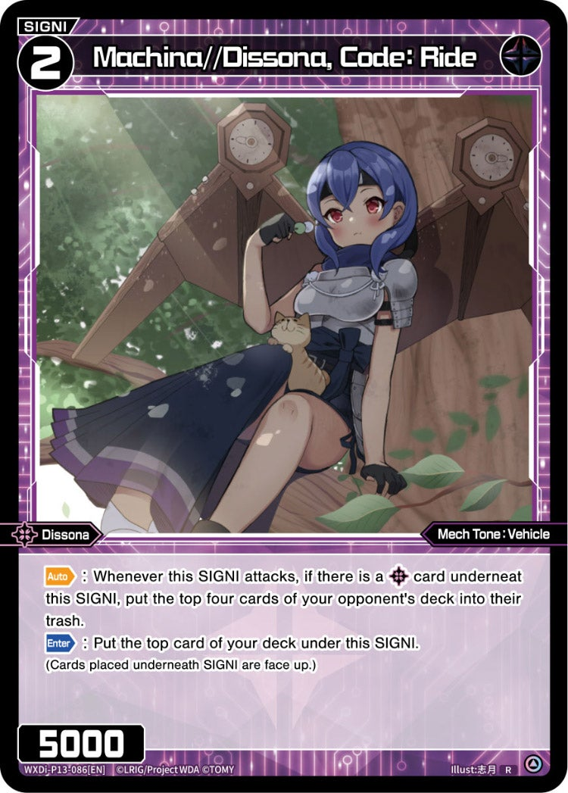

# Machina//Dissona, Code: Ride

## Thông tin lá

| Trường | Giá trị |
| --- | --- |
| Mã in | WXDi-P13-086[EN] |
| Set | WXDi-P13[EN] |
| Số thứ tự | 086 |
| Loại thẻ | SIGNI |
| Vị trí | Main Deck |
| Số bản | — (set booster, không áp dụng) |
| Màu | Đen |
| Độ hiếm | R,R(P) |
| Minh họa | 志月 |
| Level | 2 |
| Limit | — |
| Power | 5000 |
| LRIG type / Class | Mech Tone：Vehicle |
| Team / Master | — |
| Cost | — |
| Grow cost | — |
| Use timing | — |
| Life Burst | Không |

## Card text chính thức

[Auto]: Whenever this SIGNI attacks, if there is a {Dissona Icon} card underneath this SIGNI, put the top four cards of your opponent's deck into their trash.
[Enter]: Put the top card of your deck under this SIGNI.
(Cards placed underneath SIGNI are face up.)

## Power text / Life Burst

—

## Ghi chú minh họa
Artist: 志月. Ảnh R được tải từ Card List tiếng Anh.

## FAQ chính thức

**Q. When the SIGNI with underneath cards is left the field, what happens to the cards placed under it?**
A. The cards placed under are put into the Trash by the Rule-based action.

## Ảnh biến thể

- [R(P)](../images/WXDi-P13-086P-EN.jpg)

## Nguồn
[Card List/FAQ chính thức](https://www.takaratomy.co.jp/products/en.wixoss/card/card.html?card_no=WXDi-P13-086%5BEN%5D ) · [Ảnh thẻ](https://www.takaratomy.co.jp/products/en.wixoss/card/thumb/WXDi-P13-086%5BEN%5D.jpg)
