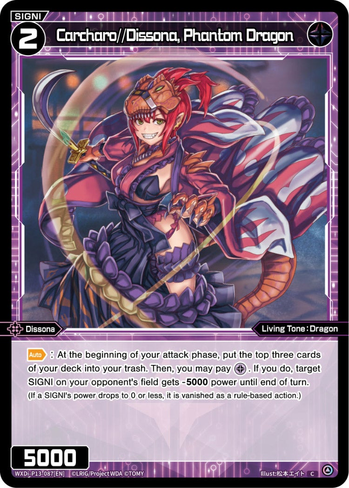

# Carcharo//Dissona, Phantom Dragon

## Thông tin lá

| Trường | Giá trị |
| --- | --- |
| Mã in | WXDi-P13-087[EN] |
| Set | WXDi-P13[EN] |
| Số thứ tự | 087 |
| Loại thẻ | SIGNI |
| Vị trí | Main Deck |
| Số bản | — (set booster, không áp dụng) |
| Màu | Đen |
| Độ hiếm | C,C(P) |
| Minh họa | 松本エイト |
| Level | 2 |
| Limit | — |
| Power | 5000 |
| LRIG type / Class | Living Tone：Dragon |
| Team / Master | — |
| Cost | — |
| Grow cost | — |
| Use timing | — |
| Life Burst | Không |

## Card text chính thức

[Auto]: At the beginning of your attack phase, put the top three cards of your deck into your trash. Then, you may pay {Black}. If you do, target SIGNI on your opponent's field gets -5000 power until end of turn.
(If a SIGNI's power drops to 0 or less, it is vanished as a rule-based action.)

## Power text / Life Burst

—

## Ghi chú minh họa
Artist: 松本エイト. Ảnh C được tải từ Card List tiếng Anh.

## FAQ chính thức

**Q. What happens if I have two or less cards in my deck when the [Auto] ability is triggered?**
A. In that case, put two or less cards from your deck into their Trash.Then if you pay the {black}, target SIGNI on your opponent's field gets -5000 power. After the effect resolves, your deck is zero cards, so you refresh.

## Ảnh biến thể

- [C(P)](../images/WXDi-P13-087P-EN.jpg)

## Nguồn
[Card List/FAQ chính thức](https://www.takaratomy.co.jp/products/en.wixoss/card/card.html?card_no=WXDi-P13-087%5BEN%5D ) · [Ảnh thẻ](https://www.takaratomy.co.jp/products/en.wixoss/card/thumb/WXDi-P13-087%5BEN%5D.jpg)
