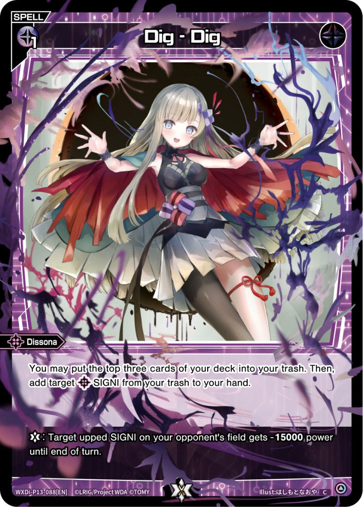

# Dig - Dig

## Thông tin lá

| Trường | Giá trị |
| --- | --- |
| Mã in | WXDi-P13-088[EN] |
| Set | WXDi-P13[EN] |
| Số thứ tự | 088 |
| Loại thẻ | SPELL |
| Vị trí | Main Deck |
| Số bản | — (set booster, không áp dụng) |
| Màu | Đen |
| Độ hiếm | C,C(P) |
| Minh họa | はしもとなおや |
| Level | — |
| Limit | — |
| Power | 0 |
| LRIG type / Class | — |
| Team / Master | — |
| Cost | 《B》×１ |
| Grow cost | — |
| Use timing | — |
| Life Burst | Có |

## Card text chính thức

You may put the top three cards of your deck into your trash. Then, add target {Dissona Icon} SIGNI from your trash to your hand.

## Power text / Life Burst

Target upped SIGNI on your opponent's field gets -15000 power until end of turn.

## Ghi chú minh họa
Artist: はしもとなおや. Ảnh C được tải từ Card List tiếng Anh.

## FAQ chính thức

**Q. When does this effect target a SIGNI in my Trash?**
A. You target a card after you have put three cards from the top of your deck into your trash. Cards put from your deck into your trash can also be targeted.

## Ảnh biến thể

- [C(P)](../images/WXDi-P13-088P-EN.jpg)

## Nguồn
[Card List/FAQ chính thức](https://www.takaratomy.co.jp/products/en.wixoss/card/card.html?card_no=WXDi-P13-088%5BEN%5D ) · [Ảnh thẻ](https://www.takaratomy.co.jp/products/en.wixoss/card/thumb/WXDi-P13-088%5BEN%5D.jpg)
