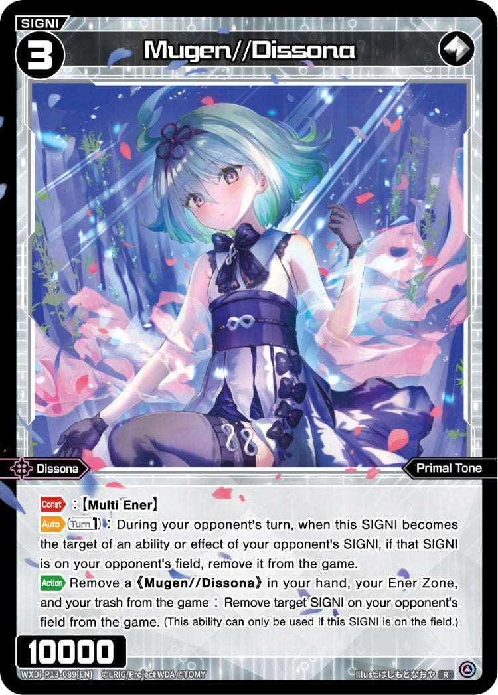

# Mugen//Dissona

## Thông tin lá

| Trường | Giá trị |
| --- | --- |
| Mã in | WXDi-P13-089[EN] |
| Set | WXDi-P13[EN] |
| Số thứ tự | 089 |
| Loại thẻ | SIGNI |
| Vị trí | Main Deck |
| Số bản | — (set booster, không áp dụng) |
| Màu | Không màu |
| Độ hiếm | R,R(P) |
| Minh họa | はしもとなおや |
| Level | 3 |
| Limit | — |
| Power | 10000 |
| LRIG type / Class | Primal Tone |
| Team / Master | — |
| Cost | — |
| Grow cost | — |
| Use timing | — |
| Life Burst | Không |

## Card text chính thức

[Constant]: 【Multi Ener】
[Auto] {1/Turn}: During your opponent's turn, when this SIGNI becomes the target of an ability or effect of your opponent's SIGNI, if that SIGNI is on your opponent's field, remove it from the game.
[Action] Remove a 《Mugen//Dissona》 in your hand, your Ener Zone, and your trash from the game: Remove target SIGNI on your opponent's field from the game. (This ability can only be used if this SIGNI is on the field.)

## Power text / Life Burst

—

## Ghi chú minh họa
Artist: はしもとなおや. Ảnh R được tải từ Card List tiếng Anh.

## FAQ chính thức

**Q. What happens to this card's [Auto] ability if this SIGNI becomes the target of a "vanish target SIGNI" effect or a "target SIGNI lose all abilities" effect?**
A. In that case, the ability will trigger when it becomes the target. After that, even if this SIGNI is varnished or loses its abilities by the effect, the ability that is already triggered will still resolve.

## Ảnh biến thể

- [R(P)](../images/WXDi-P13-089P-EN.jpg)

## Nguồn
[Card List/FAQ chính thức](https://www.takaratomy.co.jp/products/en.wixoss/card/card.html?card_no=WXDi-P13-089%5BEN%5D ) · [Ảnh thẻ](https://www.takaratomy.co.jp/products/en.wixoss/card/thumb/WXDi-P13-089%5BEN%5D.jpg)
