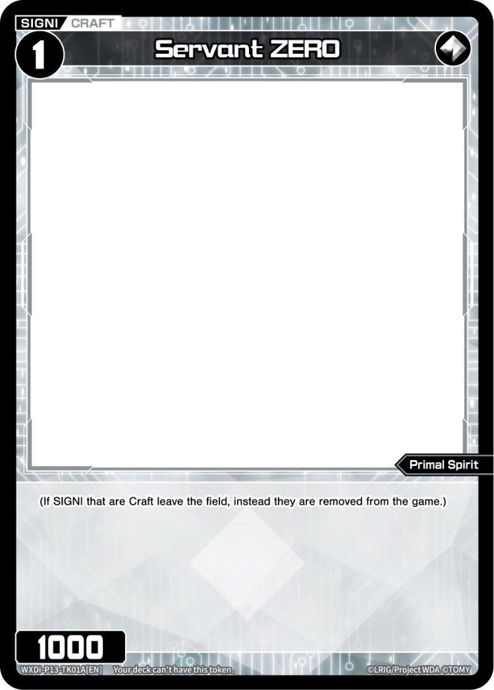

# Servant ZERO

## Thông tin lá

| Trường | Giá trị |
| --- | --- |
| Mã in | WXDi-P13-TK01A[EN] |
| Set | WXDi-P13[EN] |
| Số thứ tự | TK01A |
| Loại thẻ | SIGNI CRAFT |
| Vị trí | Main Deck |
| Số bản | — (set booster, không áp dụng) |
| Màu | Không màu |
| Độ hiếm | TK,TK(P) |
| Minh họa | — |
| Level | 1 |
| Limit | — |
| Power | 1000 |
| LRIG type / Class | Primal Spirit |
| Team / Master | — |
| Cost | — |
| Grow cost | — |
| Use timing | — |
| Life Burst | Không |

## Card text chính thức

(If SIGNI that are Craft leave the field, instead they are removed from the game.)

## Power text / Life Burst

—

## Ghi chú minh họa
Artist: —. Ảnh TK được tải từ Card List tiếng Anh.

## FAQ chính thức

— (không có FAQ riêng cho mã này trên trang FAQ tiếng Anh.)

## Ảnh biến thể

- [TK](../images/WXDi-P13-TK01AP-EN.jpg)

## Nguồn
[Card List/FAQ chính thức](https://www.takaratomy.co.jp/products/en.wixoss/card/card.html?card_no=WXDi-P13-TK01A%5BEN%5D ) · [Ảnh thẻ](https://www.takaratomy.co.jp/products/en.wixoss/card/thumb/WXDi-P13-TK01A%5BEN%5D.jpg)
