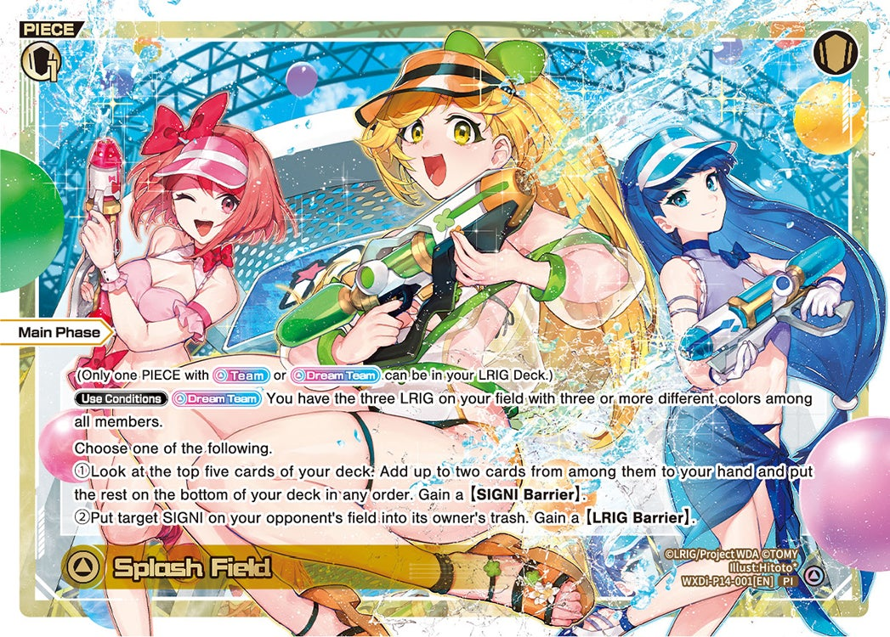

# Splash Field

## Thông tin lá

| Trường | Giá trị |
| --- | --- |
| Mã in | WXDi-P14-001[EN] |
| Set | WXDi-P14[EN] |
| Số thứ tự | 001 |
| Loại thẻ | PIECE |
| Vị trí | LRIG Deck |
| Số bản | — (set booster, không áp dụng) |
| Màu | Trắng |
| Độ hiếm | PI,LRP |
| Minh họa | Hitoto* |
| Level | — |
| Limit | — |
| Power | 0 |
| LRIG type / Class | — |
| Team / Master | — |
| Cost | 《W》×１ |
| Grow cost | — |
| Use timing | Main Phase |
| Life Burst | Không |

## Card text chính thức

(Only one PIECE with [Team] or [Dream Team] can be in your LRIG Deck.)
[Use Conditions] [Dream Team] You have the three LRIG on your field with three or more different colors among all members.

Choose one of the following.
①Look at the top five cards of your deck. Add up to two cards from among them to your hand and put the rest on the bottom of your deck in any order. Gain a 【SIGNI Barrier】.
②Put target SIGNI on your opponent's field into its owner's trash. Gain a 【LRIG Barrier】.

## Power text / Life Burst

—

## Ghi chú minh họa
Artist: Hitoto*. Ảnh PI được tải từ Card List tiếng Anh.

## FAQ chính thức

— (không có FAQ riêng cho mã này trên trang FAQ tiếng Anh.)

## Ảnh biến thể

- [LRP](../images/WXDi-P14-001P-EN.jpg)

## Nguồn
[Card List/FAQ chính thức](https://www.takaratomy.co.jp/products/en.wixoss/card/card.html?card_no=WXDi-P14-001%5BEN%5D ) · [Ảnh thẻ](https://www.takaratomy.co.jp/products/en.wixoss/card/thumb/WXDi-P14-001%5BEN%5D.jpg)
