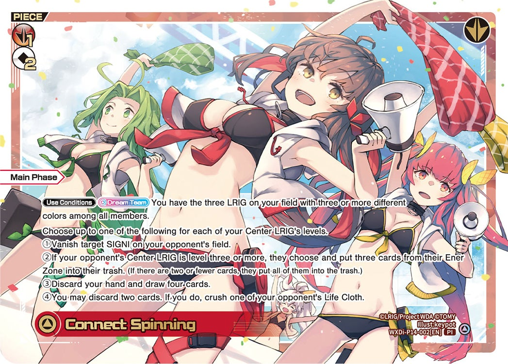

# Connect Spinning

## Thông tin lá

| Trường | Giá trị |
| --- | --- |
| Mã in | WXDi-P14-002[EN] |
| Set | WXDi-P14[EN] |
| Số thứ tự | 002 |
| Loại thẻ | PIECE |
| Vị trí | LRIG Deck |
| Số bản | — (set booster, không áp dụng) |
| Màu | Đỏ |
| Độ hiếm | PI,LRP |
| Minh họa | keypot |
| Level | — |
| Limit | — |
| Power | 0 |
| LRIG type / Class | — |
| Team / Master | — |
| Cost | 《R》×１
《C》×２ |
| Grow cost | — |
| Use timing | Main Phase |
| Life Burst | Không |

## Card text chính thức

[Use Conditions] [Dream Team] You have the three LRIG on your field with three or more different colors among all members.

Choose up to one of the following for each of your Center LRIG's levels.
①Vanish target SIGNI on your opponent's field.
②If your opponent's Center LRIG is level three or more, they choose and put three cards from their Ener Zone into their trash. (If there are two or fewer cards, they put all of them into the trash.)
③Discard your hand and draw four cards.
④You may discard two cards. If you do, crush one of your opponent's Life Cloth.

## Power text / Life Burst

—

## Ghi chú minh họa
Artist: keypot. Ảnh PI được tải từ Card List tiếng Anh.

## FAQ chính thức

— (không có FAQ riêng cho mã này trên trang FAQ tiếng Anh.)

## Ảnh biến thể

- [LRP](../images/WXDi-P14-002P-EN.jpg)

## Nguồn
[Card List/FAQ chính thức](https://www.takaratomy.co.jp/products/en.wixoss/card/card.html?card_no=WXDi-P14-002%5BEN%5D ) · [Ảnh thẻ](https://www.takaratomy.co.jp/products/en.wixoss/card/thumb/WXDi-P14-002%5BEN%5D.jpg)
