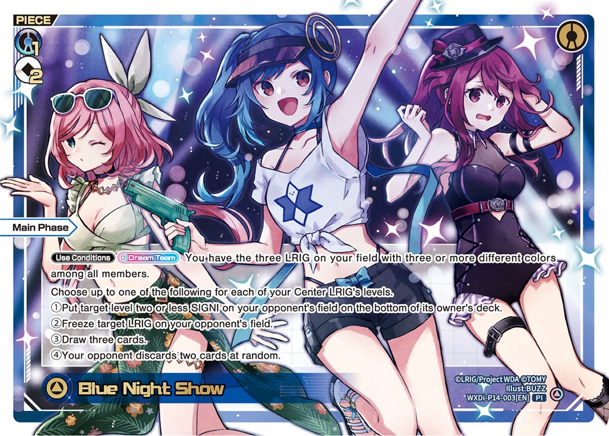

# Blue Night Show

## Thông tin lá

| Trường | Giá trị |
| --- | --- |
| Mã in | WXDi-P14-003[EN] |
| Set | WXDi-P14[EN] |
| Số thứ tự | 003 |
| Loại thẻ | PIECE |
| Vị trí | LRIG Deck |
| Số bản | — (set booster, không áp dụng) |
| Màu | Xanh dương |
| Độ hiếm | PI,LRP |
| Minh họa | BUZZ |
| Level | — |
| Limit | — |
| Power | 0 |
| LRIG type / Class | — |
| Team / Master | — |
| Cost | 《U》×１
《C》×２ |
| Grow cost | — |
| Use timing | Main Phase |
| Life Burst | Không |

## Card text chính thức

[Use Conditions] [Dream Team] You have the three LRIG on your field with three or more different colors among all members.

Choose up to one of the following for each of your Center LRIG's levels.
①Put target level two or less SIGNI on your opponent's field on the bottom of its owner's deck.
②Freeze target LRIG on your opponent's field.
③Draw three cards.
④Your opponent discards two cards at random.

## Power text / Life Burst

—

## Ghi chú minh họa
Artist: BUZZ. Ảnh PI được tải từ Card List tiếng Anh.

## FAQ chính thức

— (không có FAQ riêng cho mã này trên trang FAQ tiếng Anh.)

## Ảnh biến thể

- [LRP](../images/WXDi-P14-003P-EN.jpg)

## Nguồn
[Card List/FAQ chính thức](https://www.takaratomy.co.jp/products/en.wixoss/card/card.html?card_no=WXDi-P14-003%5BEN%5D ) · [Ảnh thẻ](https://www.takaratomy.co.jp/products/en.wixoss/card/thumb/WXDi-P14-003%5BEN%5D.jpg)
