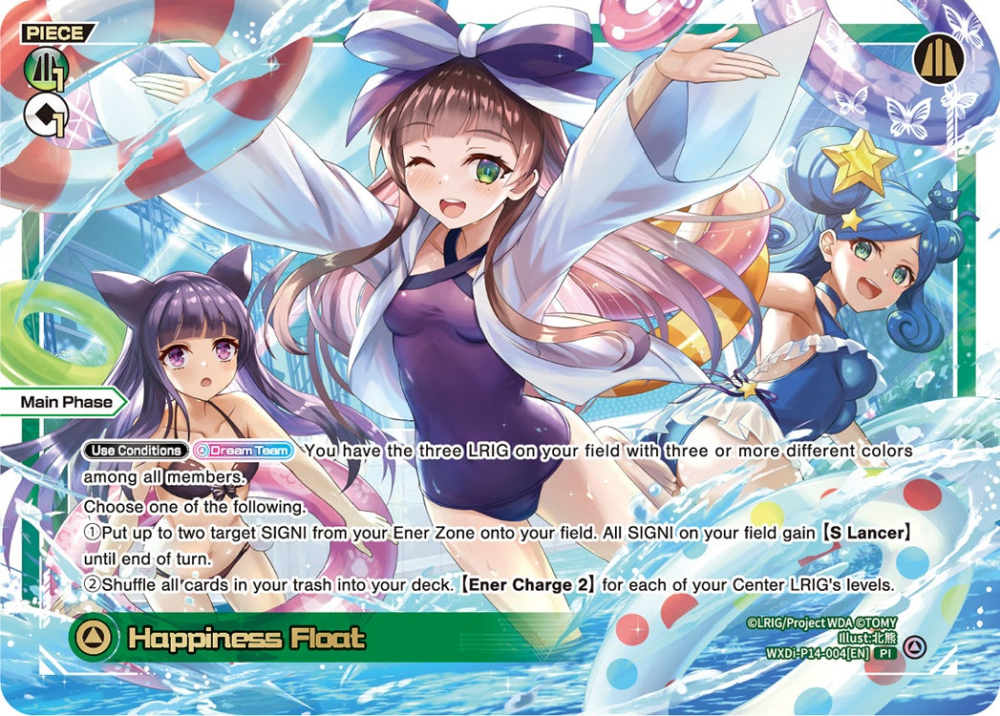

# Happiness Float

## Thông tin lá

| Trường | Giá trị |
| --- | --- |
| Mã in | WXDi-P14-004[EN] |
| Set | WXDi-P14[EN] |
| Số thứ tự | 004 |
| Loại thẻ | PIECE |
| Vị trí | LRIG Deck |
| Số bản | — (set booster, không áp dụng) |
| Màu | Xanh lá |
| Độ hiếm | PI,LRP |
| Minh họa | 北熊 |
| Level | — |
| Limit | — |
| Power | 0 |
| LRIG type / Class | — |
| Team / Master | — |
| Cost | 《G》×１
《C》×１ |
| Grow cost | — |
| Use timing | Main Phase |
| Life Burst | Không |

## Card text chính thức

[Use Conditions] [Dream Team] You have the three LRIG on your field with three or more different colors among all members.

Choose one of the following.
①Put up to two target SIGNI from your Ener Zone onto your field. All SIGNI on your field gain 【S Lancer】 until end of turn.
②Shuffle all cards in your trash into your deck. 【Ener Charge 2】 for each of your Center LRIG's levels.

## Power text / Life Burst

—

## Ghi chú minh họa
Artist: 北熊. Ảnh PI được tải từ Card List tiếng Anh.

## FAQ chính thức

— (không có FAQ riêng cho mã này trên trang FAQ tiếng Anh.)

## Ảnh biến thể

- [LRP](../images/WXDi-P14-004P-EN.jpg)

## Nguồn
[Card List/FAQ chính thức](https://www.takaratomy.co.jp/products/en.wixoss/card/card.html?card_no=WXDi-P14-004%5BEN%5D ) · [Ảnh thẻ](https://www.takaratomy.co.jp/products/en.wixoss/card/thumb/WXDi-P14-004%5BEN%5D.jpg)
