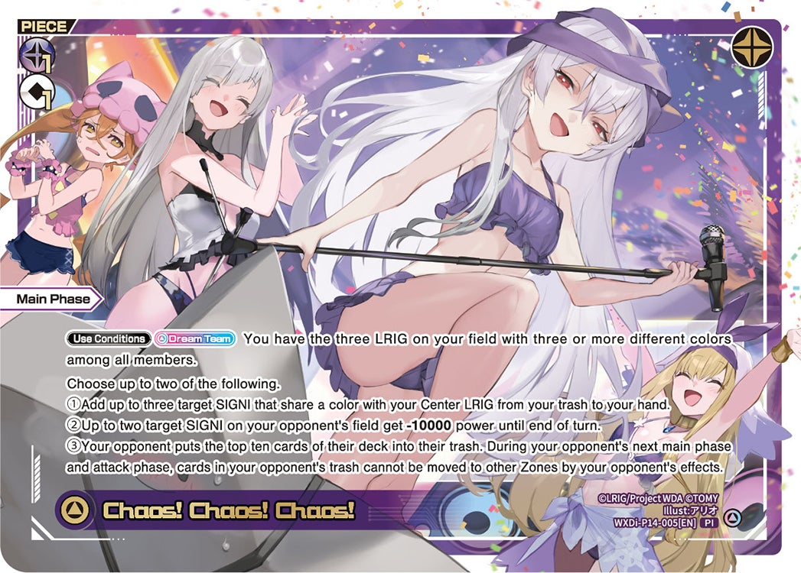

# Chaos! Chaos! Chaos!

## Thông tin lá

| Trường | Giá trị |
| --- | --- |
| Mã in | WXDi-P14-005[EN] |
| Set | WXDi-P14[EN] |
| Số thứ tự | 005 |
| Loại thẻ | PIECE |
| Vị trí | LRIG Deck |
| Số bản | — (set booster, không áp dụng) |
| Màu | Đen |
| Độ hiếm | PI,LRP |
| Minh họa | アリオ |
| Level | — |
| Limit | — |
| Power | 0 |
| LRIG type / Class | — |
| Team / Master | — |
| Cost | 《B》×１
《C》×１ |
| Grow cost | — |
| Use timing | Main Phase |
| Life Burst | Không |

## Card text chính thức

[Use Conditions] [Dream Team] You have the three LRIG on your field with three or more different colors among all members.

Choose up to two of the following.
①Add up to three target SIGNI that share a color with your Center LRIG from your trash to your hand.
②Up to two target SIGNI on your opponent's field get -10000 power until end of turn.
③Your opponent puts the top ten cards of their deck into their trash. During your opponent's next main phase and attack phase, cards in your opponent's trash cannot be moved to other Zones by your opponent's effects.

## Power text / Life Burst

—

## Ghi chú minh họa
Artist: アリオ. Ảnh PI được tải từ Card List tiếng Anh.

## FAQ chính thức

— (không có FAQ riêng cho mã này trên trang FAQ tiếng Anh.)

## Ảnh biến thể

- [LRP](../images/WXDi-P14-005P-EN.jpg)

## Nguồn
[Card List/FAQ chính thức](https://www.takaratomy.co.jp/products/en.wixoss/card/card.html?card_no=WXDi-P14-005%5BEN%5D ) · [Ảnh thẻ](https://www.takaratomy.co.jp/products/en.wixoss/card/thumb/WXDi-P14-005%5BEN%5D.jpg)
