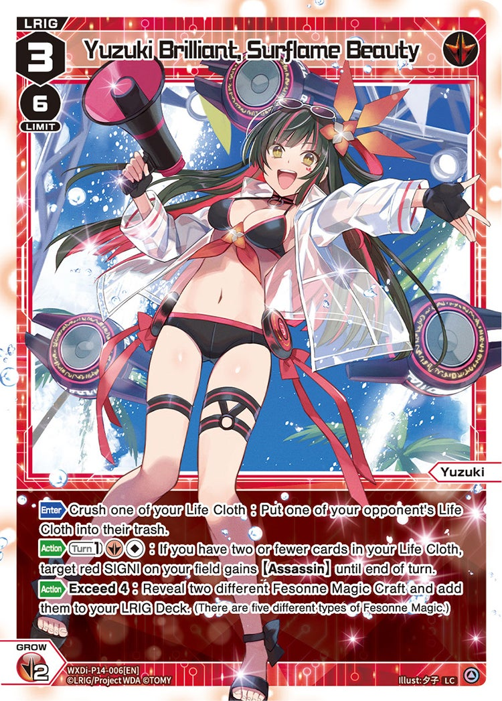

# Yuzuki Brilliant, Surflame Beauty

## Thông tin lá

| Trường | Giá trị |
| --- | --- |
| Mã in | WXDi-P14-006[EN] |
| Set | WXDi-P14[EN] |
| Số thứ tự | 006 |
| Loại thẻ | LRIG |
| Vị trí | LRIG Deck |
| Số bản | — (set booster, không áp dụng) |
| Màu | Đỏ |
| Độ hiếm | LC,LR,LRP,UR |
| Minh họa | 夕子 / Niθ |
| Level | 3 |
| Limit | 6 |
| Power | 0 |
| LRIG type / Class | Yuzuki |
| Team / Master | — |
| Cost | — |
| Grow cost | 《R》×２ |
| Use timing | — |
| Life Burst | Không |

## Card text chính thức

[Enter] Crush one of your Life Cloth: Put one of your opponent's Life Cloth into their trash.
[Action] {1/Turn} {Red} {Colorless}: If you have two or fewer cards in your Life Cloth, target red SIGNI on your field gains 【Assassin】 until end of turn.
[Action] Exceed 4: Reveal two different Fesonne Magic Craft and add them to your LRIG Deck. (There are five different types of Fesonne Magic.)

## Power text / Life Burst

—

## Ghi chú minh họa
Artist: 夕子 / Niθ. Ảnh LC được tải từ Card List tiếng Anh.

## FAQ chính thức

— (không có FAQ riêng cho mã này trên trang FAQ tiếng Anh.)

## Ảnh biến thể

- [LRP](../images/WXDi-P14-006P-EN.jpg)
- [LR](../images/WXDi-P14-006R-EN.jpg)
- [UR](../images/WXDi-P14-006U-EN.jpg)

## Nguồn
[Card List/FAQ chính thức](https://www.takaratomy.co.jp/products/en.wixoss/card/card.html?card_no=WXDi-P14-006%5BEN%5D ) · [Ảnh thẻ](https://www.takaratomy.co.jp/products/en.wixoss/card/thumb/WXDi-P14-006%5BEN%5D.jpg)
