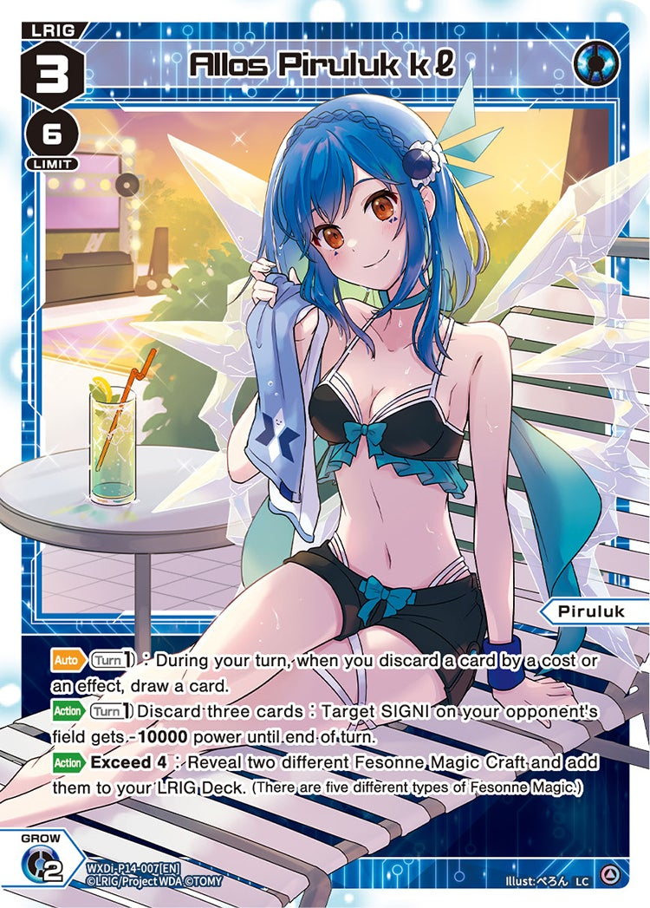

# Allos Piruluk kℓ

## Thông tin lá

| Trường | Giá trị |
| --- | --- |
| Mã in | WXDi-P14-007[EN] |
| Set | WXDi-P14[EN] |
| Số thứ tự | 007 |
| Loại thẻ | LRIG |
| Vị trí | LRIG Deck |
| Số bản | — (set booster, không áp dụng) |
| Màu | Xanh dương |
| Độ hiếm | LC,LR,LRP,UR |
| Minh họa | ぺろん
マツモトミツアキ |
| Level | 3 |
| Limit | 6 |
| Power | 0 |
| LRIG type / Class | Piruluk |
| Team / Master | — |
| Cost | — |
| Grow cost | 《U》×２ |
| Use timing | — |
| Life Burst | Không |

## Card text chính thức

[Auto] {1/Turn}: During your turn, when you discard a card by a cost or an effect, draw a card.
[Action] {1/Turn} Discard three cards: Target SIGNI on your opponent's field gets -10000 power until end of turn.
[Action] Exceed 4: Reveal two different Fesonne Magic Craft and add them to your LRIG Deck. (There are five different types of Fesonne Magic.)

## Power text / Life Burst

—

## Ghi chú minh họa
Artist: ぺろん
マツモトミツアキ. Ảnh LC được tải từ Card List tiếng Anh.

## FAQ chính thức

— (không có FAQ riêng cho mã này trên trang FAQ tiếng Anh.)

## Ảnh biến thể

- [LRP](../images/WXDi-P14-007P-EN.jpg)
- [LR](../images/WXDi-P14-007R-EN.jpg)
- [UR](../images/WXDi-P14-007U-EN.jpg)

## Nguồn
[Card List/FAQ chính thức](https://www.takaratomy.co.jp/products/en.wixoss/card/card.html?card_no=WXDi-P14-007%5BEN%5D ) · [Ảnh thẻ](https://www.takaratomy.co.jp/products/en.wixoss/card/thumb/WXDi-P14-007%5BEN%5D.jpg)
