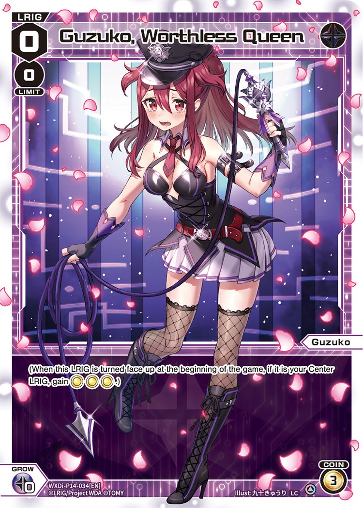

# Guzuko, Worthless Queen

## Thông tin lá

| Trường | Giá trị |
| --- | --- |
| Mã in | WXDi-P14-034[EN] |
| Set | WXDi-P14[EN] |
| Số thứ tự | 034 |
| Loại thẻ | LRIG |
| Vị trí | LRIG Deck |
| Số bản | — (set booster, không áp dụng) |
| Màu | Đen |
| Độ hiếm | LC,LC(P) |
| Minh họa | 再録 |
| Level | 0 |
| Limit | 0 |
| Power | 0 |
| LRIG type / Class | Guzuko |
| Team / Master | — |
| Cost | — |
| Grow cost | 《B》×０ |
| Use timing | — |
| Life Burst | Không |

## Card text chính thức

(When this LRIG is turned face up at the beginning of the game, if it is your Center LRIG, gain {Coin Icon} {Coin Icon} {Coin Icon}.)

## Power text / Life Burst

—

## Ghi chú minh họa
Artist: 再録. Ảnh LC được tải từ Card List tiếng Anh.

## FAQ chính thức

— (không có FAQ riêng cho mã này trên trang FAQ tiếng Anh.)

## Ảnh biến thể

- LC(P): không có ảnh biến thể trên CDN; dùng ảnh gốc.

## Nguồn
[Card List/FAQ chính thức](https://www.takaratomy.co.jp/products/en.wixoss/card/card.html?card_no=WXDi-P14-034%5BEN%5D ) · [Ảnh thẻ](https://www.takaratomy.co.jp/products/en.wixoss/card/thumb/WXDi-P14-034%5BEN%5D.jpg)
