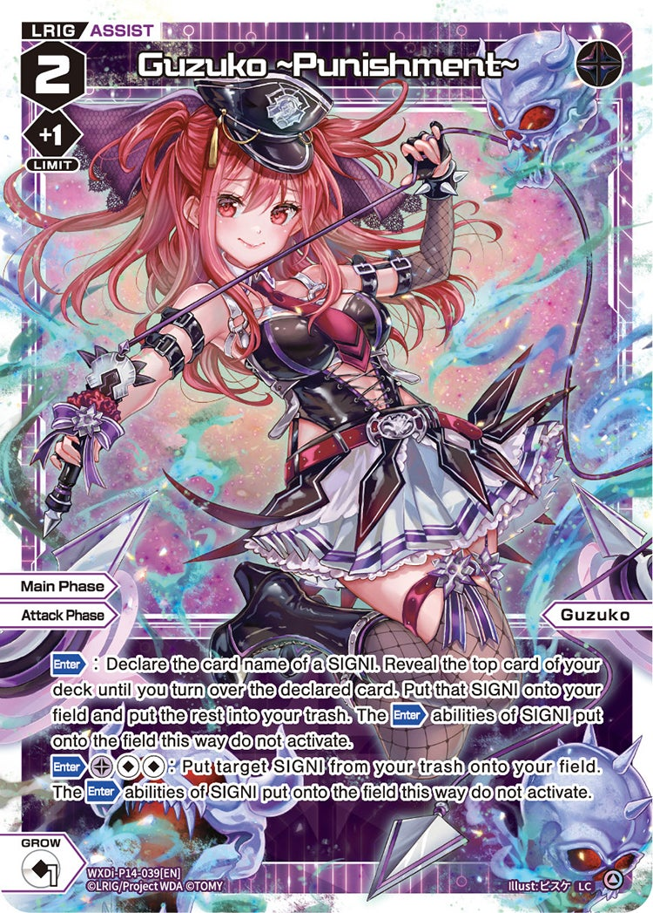

# Guzuko ~Punishment~

## Thông tin lá

| Trường | Giá trị |
| --- | --- |
| Mã in | WXDi-P14-039[EN] |
| Set | WXDi-P14[EN] |
| Số thứ tự | 039 |
| Loại thẻ | ASSIST LRIG |
| Vị trí | LRIG Deck |
| Số bản | — (set booster, không áp dụng) |
| Màu | Đen |
| Độ hiếm | LC,LC(P) |
| Minh họa | ピスケ |
| Level | 2 |
| Limit | ＋１ |
| Power | 0 |
| LRIG type / Class | Guzuko |
| Team / Master | — |
| Cost | — |
| Grow cost | 《C》×１ |
| Use timing | Main Phase / Attack Phase |
| Life Burst | Không |

## Card text chính thức

[Enter]: Declare the card name of a SIGNI. Reveal the top card of your deck until you turn over the declared card. Put that SIGNI onto your field and put the rest into your trash. The [Enter] abilities of SIGNI put onto the field this way do not activate.
[Enter] {Black} {Colorless} {Colorless}: Put target SIGNI from your trash onto your field. The [Enter] abilities of SIGNI put onto the field this way do not activate.

## Power text / Life Burst

—

## Ghi chú minh họa
Artist: ピスケ. Ảnh LC được tải từ Card List tiếng Anh.

## FAQ chính thức

— (không có FAQ riêng cho mã này trên trang FAQ tiếng Anh.)

## Ảnh biến thể

- [LC(P)](../images/WXDi-P14-039P-EN.jpg)

## Nguồn
[Card List/FAQ chính thức](https://www.takaratomy.co.jp/products/en.wixoss/card/card.html?card_no=WXDi-P14-039%5BEN%5D ) · [Ảnh thẻ](https://www.takaratomy.co.jp/products/en.wixoss/card/thumb/WXDi-P14-039%5BEN%5D.jpg)
