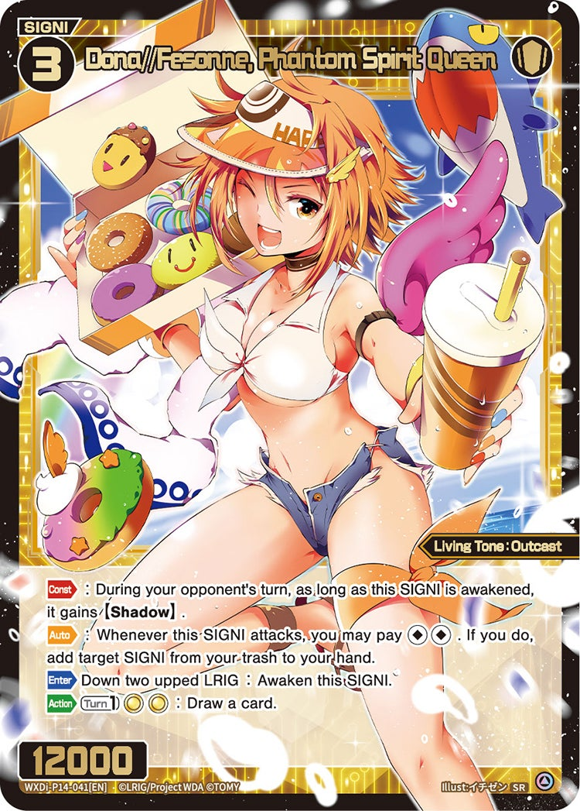

# Dona//Fesonne, Phantom Spirit Queen

## Thông tin lá

| Trường | Giá trị |
| --- | --- |
| Mã in | WXDi-P14-041[EN] |
| Set | WXDi-P14[EN] |
| Số thứ tự | 041 |
| Loại thẻ | SIGNI |
| Vị trí | Main Deck |
| Số bản | — (set booster, không áp dụng) |
| Màu | Trắng |
| Độ hiếm | SR,SRP |
| Minh họa | イチゼン |
| Level | 3 |
| Limit | — |
| Power | 12000 |
| LRIG type / Class | Living Tone：Outcast |
| Team / Master | — |
| Cost | — |
| Grow cost | — |
| Use timing | — |
| Life Burst | Không |

## Card text chính thức

[Constant]: During your opponent's turn, as long as this SIGNI is awakened, it gains 【Shadow】.
[Auto]: Whenever this SIGNI attacks, you may pay {Colorless} {Colorless}. If you do, add target SIGNI from your trash to your hand.
[Enter] Down two upped LRIG: Awaken this SIGNI.
[Action] {1/Turn} {Coin Icon} {Coin Icon}: Draw a card.

## Power text / Life Burst

—

## Ghi chú minh họa
Artist: イチゼン. Ảnh SR được tải từ Card List tiếng Anh.

## FAQ chính thức

— (không có FAQ riêng cho mã này trên trang FAQ tiếng Anh.)

## Ảnh biến thể

- [SRP](../images/WXDi-P14-041P-EN.jpg)

## Nguồn
[Card List/FAQ chính thức](https://www.takaratomy.co.jp/products/en.wixoss/card/card.html?card_no=WXDi-P14-041%5BEN%5D ) · [Ảnh thẻ](https://www.takaratomy.co.jp/products/en.wixoss/card/thumb/WXDi-P14-041%5BEN%5D.jpg)
