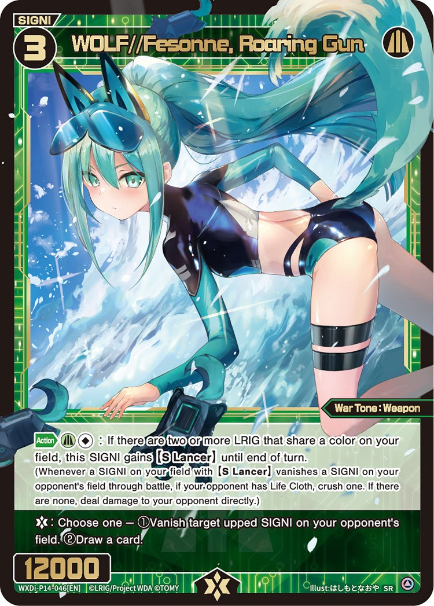

# WOLF//Fesonne, Roaring Gun

## Thông tin lá

| Trường | Giá trị |
| --- | --- |
| Mã in | WXDi-P14-046[EN] |
| Set | WXDi-P14[EN] |
| Số thứ tự | 046 |
| Loại thẻ | SIGNI |
| Vị trí | Main Deck |
| Số bản | — (set booster, không áp dụng) |
| Màu | Xanh lá |
| Độ hiếm | SR,SRP |
| Minh họa | はしもとなおや |
| Level | 3 |
| Limit | — |
| Power | 12000 |
| LRIG type / Class | War Tone：Weapon |
| Team / Master | — |
| Cost | — |
| Grow cost | — |
| Use timing | — |
| Life Burst | Có |

## Card text chính thức

[Action] {Green} {Colorless}: If there are two or more LRIG that share a color on your field, this SIGNI gains 【S Lancer】 until end of turn.
(Whenever a SIGNI on your field with 【S Lancer】 vanishes a SIGNI on your opponent's field through battle, if your opponent has Life Cloth, crush one. If there are none, deal damage to your opponent directly.)

## Power text / Life Burst

Choose one — ①Vanish target upped SIGNI on your opponent's field. ②Draw a card.

## Ghi chú minh họa
Artist: はしもとなおや. Ảnh SR được tải từ Card List tiếng Anh.

## FAQ chính thức

— (không có FAQ riêng cho mã này trên trang FAQ tiếng Anh.)

## Ảnh biến thể

- [SRP](../images/WXDi-P14-046P-EN.jpg)

## Nguồn
[Card List/FAQ chính thức](https://www.takaratomy.co.jp/products/en.wixoss/card/card.html?card_no=WXDi-P14-046%5BEN%5D ) · [Ảnh thẻ](https://www.takaratomy.co.jp/products/en.wixoss/card/thumb/WXDi-P14-046%5BEN%5D.jpg)
