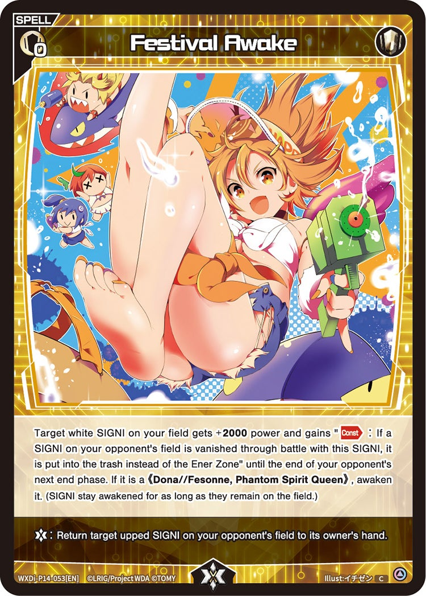

# Festival Awake

## Thông tin lá

| Trường | Giá trị |
| --- | --- |
| Mã in | WXDi-P14-053[EN] |
| Set | WXDi-P14[EN] |
| Số thứ tự | 053 |
| Loại thẻ | SPELL |
| Vị trí | Main Deck |
| Số bản | — (set booster, không áp dụng) |
| Màu | Trắng |
| Độ hiếm | C,C(P) |
| Minh họa | イチゼン |
| Level | — |
| Limit | — |
| Power | 0 |
| LRIG type / Class | — |
| Team / Master | — |
| Cost | 《W》×０ |
| Grow cost | — |
| Use timing | — |
| Life Burst | Có |

## Card text chính thức

Target white SIGNI on your field gets +2000 power and gains
"[Constant]: If a SIGNI on your opponent's field is vanished through battle with this SIGNI, it is put into the trash instead of the Ener Zone" until the end of your opponent's next end phase. If it is a 《Dona//Fesonne, Phantom Spirit Queen》, awaken it. (SIGNI stay awakened for as long as they remain on the field.)

## Power text / Life Burst

Return target upped SIGNI on your opponent's field to its owner's hand.

## Ghi chú minh họa
Artist: イチゼン. Ảnh C được tải từ Card List tiếng Anh.

## FAQ chính thức

— (không có FAQ riêng cho mã này trên trang FAQ tiếng Anh.)

## Ảnh biến thể

- [C(P)](../images/WXDi-P14-053P-EN.jpg)

## Nguồn
[Card List/FAQ chính thức](https://www.takaratomy.co.jp/products/en.wixoss/card/card.html?card_no=WXDi-P14-053%5BEN%5D ) · [Ảnh thẻ](https://www.takaratomy.co.jp/products/en.wixoss/card/thumb/WXDi-P14-053%5BEN%5D.jpg)
