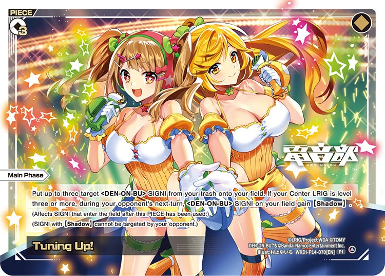

# Tuning Up!

## Thông tin lá

| Trường | Giá trị |
| --- | --- |
| Mã in | WXDi-P14-070[EN] |
| Set | WXDi-P14[EN] |
| Số thứ tự | 070 |
| Loại thẻ | PIECE |
| Vị trí | LRIG Deck |
| Số bản | — (set booster, không áp dụng) |
| Màu | Không màu |
| Độ hiếm | PI,LRP |
| Minh họa | 村上ゆいち |
| Level | — |
| Limit | — |
| Power | 0 |
| LRIG type / Class | — |
| Team / Master | — |
| Cost | 《C》×３ |
| Grow cost | — |
| Use timing | Main Phase |
| Life Burst | Không |

## Card text chính thức

Put up to three target <DEN-ON-BU> SIGNI from your trash onto your field. If your Center LRIG is level three or more, during your opponent's next turn, <DEN-ON-BU> SIGNI on your field gain 【Shadow】. (Affects SIGNI that enter the field after this PIECE has been used.)
(SIGNI with 【Shadow】 cannot be targeted by your opponent.)

## Power text / Life Burst

—

## Ghi chú minh họa
Artist: 村上ゆいち. Ảnh PI được tải từ Card List tiếng Anh.

## FAQ chính thức

— (không có FAQ riêng cho mã này trên trang FAQ tiếng Anh.)

## Ảnh biến thể

- [LRP](../images/WXDi-P14-070P-EN.jpg)

## Nguồn
[Card List/FAQ chính thức](https://www.takaratomy.co.jp/products/en.wixoss/card/card.html?card_no=WXDi-P14-070%5BEN%5D ) · [Ảnh thẻ](https://www.takaratomy.co.jp/products/en.wixoss/card/thumb/WXDi-P14-070%5BEN%5D.jpg)
