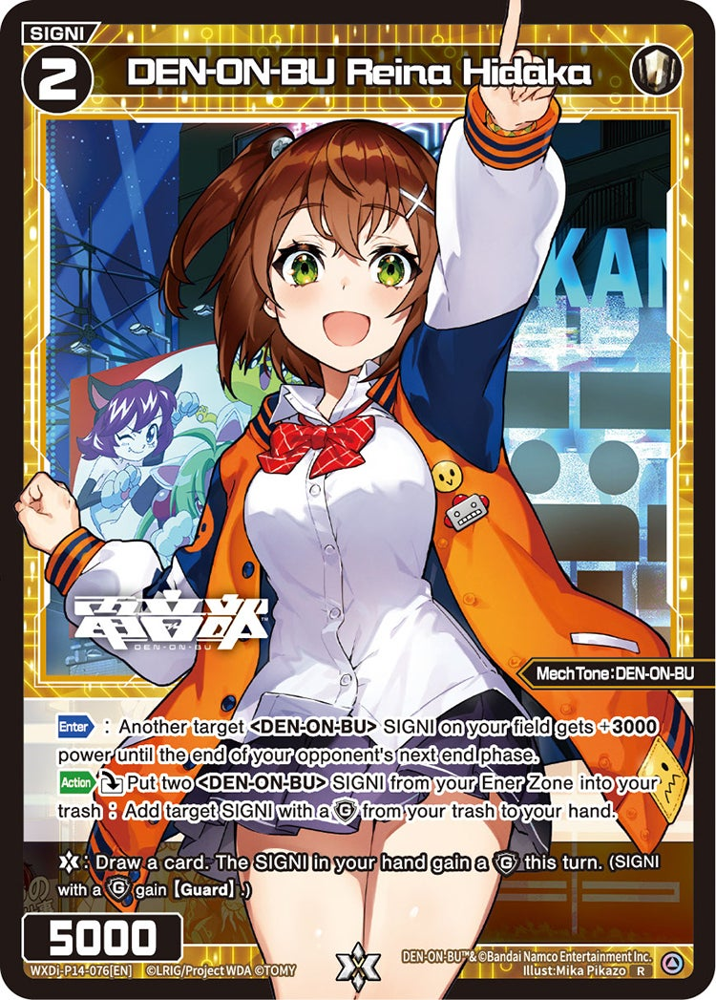

# DEN-ON-BU Reina Hidaka

## Thông tin lá

| Trường | Giá trị |
| --- | --- |
| Mã in | WXDi-P14-076[EN] |
| Set | WXDi-P14[EN] |
| Số thứ tự | 076 |
| Loại thẻ | SIGNI |
| Vị trí | Main Deck |
| Số bản | — (set booster, không áp dụng) |
| Màu | Trắng |
| Độ hiếm | R,R(P),R(P') |
| Minh họa | Mika Pikazo |
| Level | 2 |
| Limit | — |
| Power | 5000 |
| LRIG type / Class | Mech Tone：DEN-ON-BU |
| Team / Master | — |
| Cost | — |
| Grow cost | — |
| Use timing | — |
| Life Burst | Có |

## Card text chính thức

[Enter]: Another target <DEN-ON-BU> SIGNI on your field gets +3000 power until the end of your opponent's next end phase.
[Action] {Down} Put two <DEN-ON-BU> SIGNI from your Ener Zone into your trash: Add target SIGNI with a {Guard Icon} from your trash to your hand.

## Power text / Life Burst

Draw a card. The SIGNI in your hand gain a {Guard Icon} this turn. (SIGNI with a {Guard Icon} gain 【Guard】.)

## Ghi chú minh họa
Artist: Mika Pikazo. Ảnh R được tải từ Card List tiếng Anh.

## FAQ chính thức

— (không có FAQ riêng cho mã này trên trang FAQ tiếng Anh.)

## Ảnh biến thể

- [R(P)](../images/WXDi-P14-076P-EN.jpg)
- [R(P')](../images/WXDi-P14-076PS-EN.jpg)

## Nguồn
[Card List/FAQ chính thức](https://www.takaratomy.co.jp/products/en.wixoss/card/card.html?card_no=WXDi-P14-076%5BEN%5D ) · [Ảnh thẻ](https://www.takaratomy.co.jp/products/en.wixoss/card/thumb/WXDi-P14-076%5BEN%5D.jpg)
