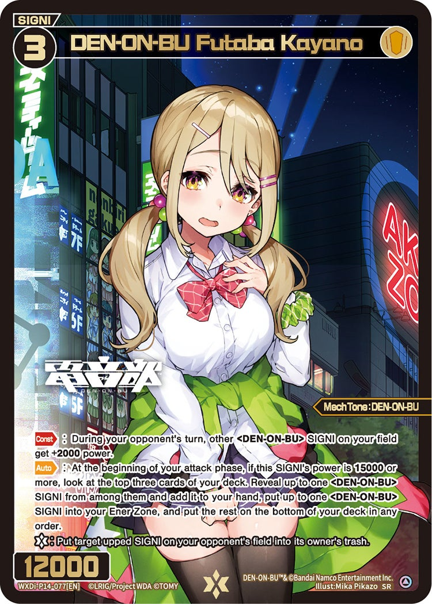

# DEN-ON-BU Futaba Kayano

## Thông tin lá

| Trường | Giá trị |
| --- | --- |
| Mã in | WXDi-P14-077[EN] |
| Set | WXDi-P14[EN] |
| Số thứ tự | 077 |
| Loại thẻ | SIGNI |
| Vị trí | Main Deck |
| Số bản | — (set booster, không áp dụng) |
| Màu | Trắng |
| Độ hiếm | SR,SRP |
| Minh họa | 通常版：Mika Pikazo
パラ版：アカバネ |
| Level | 3 |
| Limit | — |
| Power | 12000 |
| LRIG type / Class | Mech Tone：DEN-ON-BU |
| Team / Master | — |
| Cost | — |
| Grow cost | — |
| Use timing | — |
| Life Burst | Có |

## Card text chính thức

[Constant]: During your opponent's turn, other <DEN-ON-BU> SIGNI on your field get +2000 power.
[Auto]: At the beginning of your attack phase, if this SIGNI's power is 15000 or more, look at the top three cards of your deck. Reveal up to one <DEN-ON-BU> SIGNI from among them and add it to your hand, put up to one <DEN-ON-BU> SIGNI into your Ener Zone, and put the rest on the bottom of your deck in any order.

## Power text / Life Burst

Put target upped SIGNI on your opponent's field into its owner's trash.

## Ghi chú minh họa
Artist: 通常版：Mika Pikazo
パラ版：アカバネ. Ảnh SR được tải từ Card List tiếng Anh.

## FAQ chính thức

— (không có FAQ riêng cho mã này trên trang FAQ tiếng Anh.)

## Ảnh biến thể

- [SRP](../images/WXDi-P14-077P-EN.jpg)

## Nguồn
[Card List/FAQ chính thức](https://www.takaratomy.co.jp/products/en.wixoss/card/card.html?card_no=WXDi-P14-077%5BEN%5D ) · [Ảnh thẻ](https://www.takaratomy.co.jp/products/en.wixoss/card/thumb/WXDi-P14-077%5BEN%5D.jpg)
