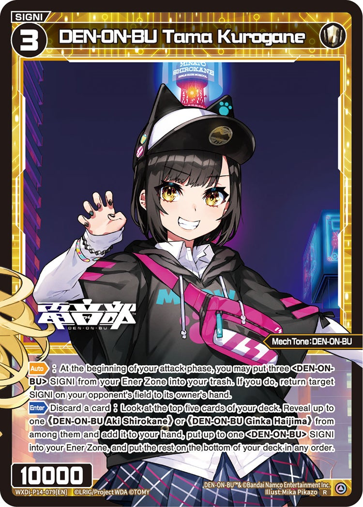

# DEN-ON-BU Tama Kurogane

## Thông tin lá

| Trường | Giá trị |
| --- | --- |
| Mã in | WXDi-P14-079[EN] |
| Set | WXDi-P14[EN] |
| Số thứ tự | 079 |
| Loại thẻ | SIGNI |
| Vị trí | Main Deck |
| Số bản | — (set booster, không áp dụng) |
| Màu | Trắng |
| Độ hiếm | R,R(P),R(P') |
| Minh họa | Mika Pikazo / Nardack |
| Level | 3 |
| Limit | — |
| Power | 10000 |
| LRIG type / Class | Mech Tone：DEN-ON-BU |
| Team / Master | — |
| Cost | — |
| Grow cost | — |
| Use timing | — |
| Life Burst | Không |

## Card text chính thức

[Auto]: At the beginning of your attack phase, you may put three <DEN-ON-BU> SIGNI from your Ener Zone into your trash. If you do, return target SIGNI on your opponent's field to its owner's hand.
[Enter] Discard a card: Look at the top five cards of your deck. Reveal up to one 《DEN-ON-BU Aki Shirokane》 or 《DEN-ON-BU Ginka Haijima》 from among them and add it to your hand, put up to one <DEN-ON-BU> SIGNI into your Ener Zone, and put the rest on the bottom of your deck in any order.

## Power text / Life Burst

—

## Ghi chú minh họa
Artist: Mika Pikazo / Nardack. Ảnh R được tải từ Card List tiếng Anh.

## FAQ chính thức

— (không có FAQ riêng cho mã này trên trang FAQ tiếng Anh.)

## Ảnh biến thể

- [R(P)](../images/WXDi-P14-079P-EN.jpg)
- [R(P')](../images/WXDi-P14-079PS-EN.jpg)

## Nguồn
[Card List/FAQ chính thức](https://www.takaratomy.co.jp/products/en.wixoss/card/card.html?card_no=WXDi-P14-079%5BEN%5D ) · [Ảnh thẻ](https://www.takaratomy.co.jp/products/en.wixoss/card/thumb/WXDi-P14-079%5BEN%5D.jpg)
