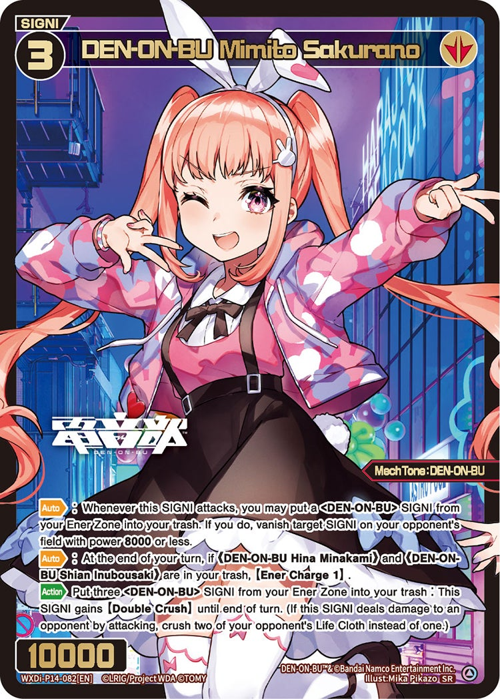

# DEN-ON-BU Mimito Sakurano

## Thông tin lá

| Trường | Giá trị |
| --- | --- |
| Mã in | WXDi-P14-082[EN] |
| Set | WXDi-P14[EN] |
| Số thứ tự | 082 |
| Loại thẻ | SIGNI |
| Vị trí | Main Deck |
| Số bản | — (set booster, không áp dụng) |
| Màu | Đỏ |
| Độ hiếm | SR,SRP |
| Minh họa | 通常版：Mika Pikazo
パラ版：茶ちえ |
| Level | 3 |
| Limit | — |
| Power | 10000 |
| LRIG type / Class | Mech Tone：DEN-ON-BU |
| Team / Master | — |
| Cost | — |
| Grow cost | — |
| Use timing | — |
| Life Burst | Không |

## Card text chính thức

[Auto]: Whenever this SIGNI attacks, you may put a <DEN-ON-BU> SIGNI from your Ener Zone into your trash. If you do, vanish target SIGNI on your opponent's field with power 8000 or less.
[Auto]: At the end of your turn, if 《DEN-ON-BU Hina Minakami》 and 《DEN-ON-BU Shian Inubousaki》 are in your trash, 【Ener Charge 1】.
[Action] Put three <DEN-ON-BU> SIGNI from your Ener Zone into your trash: This SIGNI gains 【Double Crush】 until end of turn. (If this SIGNI deals damage to an opponent by attacking, crush two of your opponent's Life Cloth instead of one.)

## Power text / Life Burst

—

## Ghi chú minh họa
Artist: 通常版：Mika Pikazo
パラ版：茶ちえ. Ảnh SR được tải từ Card List tiếng Anh.

## FAQ chính thức

— (không có FAQ riêng cho mã này trên trang FAQ tiếng Anh.)

## Ảnh biến thể

- [SRP](../images/WXDi-P14-082P-EN.jpg)

## Nguồn
[Card List/FAQ chính thức](https://www.takaratomy.co.jp/products/en.wixoss/card/card.html?card_no=WXDi-P14-082%5BEN%5D ) · [Ảnh thẻ](https://www.takaratomy.co.jp/products/en.wixoss/card/thumb/WXDi-P14-082%5BEN%5D.jpg)
