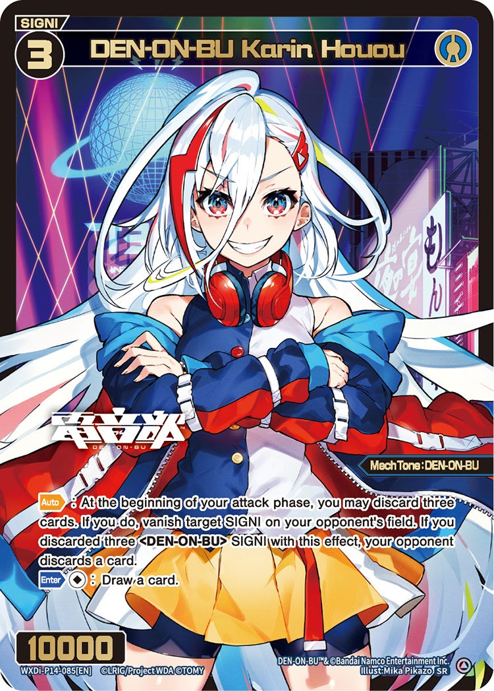

# DEN-ON-BU Karin Houou

## Thông tin lá

| Trường | Giá trị |
| --- | --- |
| Mã in | WXDi-P14-085[EN] |
| Set | WXDi-P14[EN] |
| Số thứ tự | 085 |
| Loại thẻ | SIGNI |
| Vị trí | Main Deck |
| Số bản | — (set booster, không áp dụng) |
| Màu | Xanh dương |
| Độ hiếm | SR,SRP |
| Minh họa | 通常版：Mika Pikazo
パラ版：Hitoto* |
| Level | 3 |
| Limit | — |
| Power | 10000 |
| LRIG type / Class | Mech Tone：DEN-ON-BU |
| Team / Master | — |
| Cost | — |
| Grow cost | — |
| Use timing | — |
| Life Burst | Không |

## Card text chính thức

[Auto]: At the beginning of your attack phase, you may discard three cards. If you do, vanish target SIGNI on your opponent's field. If you discarded three <DEN-ON-BU> SIGNI with this effect, your opponent discards a card.
[Enter] {Colorless}: Draw a card.

## Power text / Life Burst

—

## Ghi chú minh họa
Artist: 通常版：Mika Pikazo
パラ版：Hitoto*. Ảnh SR được tải từ Card List tiếng Anh.

## FAQ chính thức

— (không có FAQ riêng cho mã này trên trang FAQ tiếng Anh.)

## Ảnh biến thể

- [SRP](../images/WXDi-P14-085P-EN.jpg)

## Nguồn
[Card List/FAQ chính thức](https://www.takaratomy.co.jp/products/en.wixoss/card/card.html?card_no=WXDi-P14-085%5BEN%5D ) · [Ảnh thẻ](https://www.takaratomy.co.jp/products/en.wixoss/card/thumb/WXDi-P14-085%5BEN%5D.jpg)
