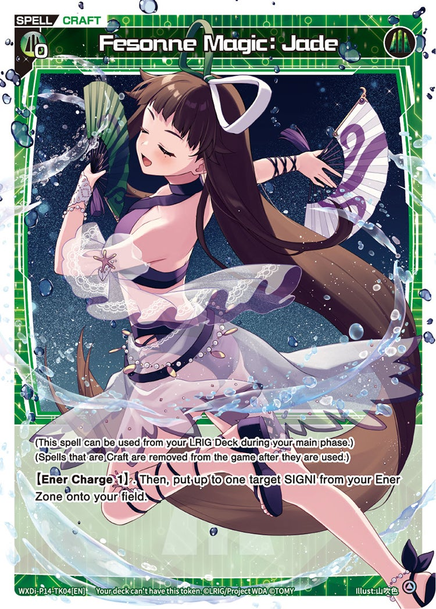

# Fesonne Magic: Jade

## Thông tin lá

| Trường | Giá trị |
| --- | --- |
| Mã in | WXDi-P14-TK04[EN] |
| Set | WXDi-P14[EN] |
| Số thứ tự | TK04 |
| Loại thẻ | SPELL CRAFT |
| Vị trí | Main Deck |
| Số bản | — (set booster, không áp dụng) |
| Màu | Xanh lá |
| Độ hiếm | TK,TK(P) |
| Minh họa | 山吹色 |
| Level | — |
| Limit | — |
| Power | 0 |
| LRIG type / Class | — |
| Team / Master | — |
| Cost | 《G》×０ |
| Grow cost | — |
| Use timing | — |
| Life Burst | Không |

## Card text chính thức

(This spell can be used from your LRIG Deck during your main phase.)
(Spells that are Craft are removed from the game after they are used.)

【Ener Charge 1】. Then, put up to one target SIGNI from your Ener Zone onto your field.

## Power text / Life Burst

—

## Ghi chú minh họa
Artist: 山吹色. Ảnh TK được tải từ Card List tiếng Anh.

## FAQ chính thức

— (không có FAQ riêng cho mã này trên trang FAQ tiếng Anh.)

## Ảnh biến thể

- [TK](../images/WXDi-P14-TK04P-EN.jpg)

## Nguồn
[Card List/FAQ chính thức](https://www.takaratomy.co.jp/products/en.wixoss/card/card.html?card_no=WXDi-P14-TK04%5BEN%5D ) · [Ảnh thẻ](https://www.takaratomy.co.jp/products/en.wixoss/card/thumb/WXDi-P14-TK04%5BEN%5D.jpg)
