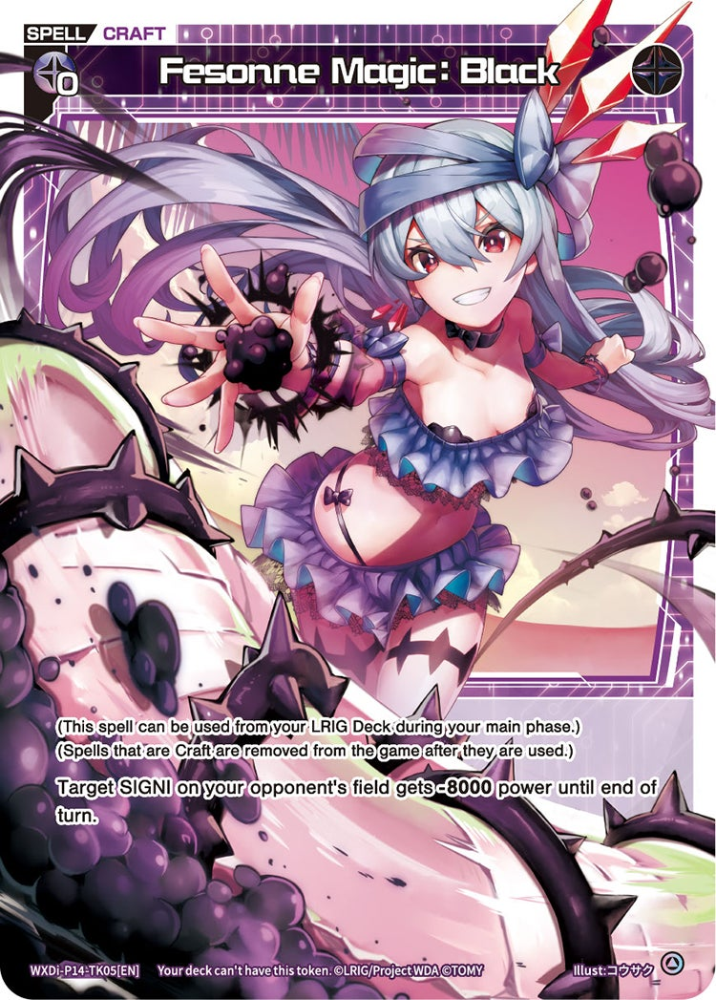

# Fesonne Magic: Black

## Thông tin lá

| Trường | Giá trị |
| --- | --- |
| Mã in | WXDi-P14-TK05[EN] |
| Set | WXDi-P14[EN] |
| Số thứ tự | TK05 |
| Loại thẻ | SPELL CRAFT |
| Vị trí | Main Deck |
| Số bản | — (set booster, không áp dụng) |
| Màu | Đen |
| Độ hiếm | TK,TK(P) |
| Minh họa | コウサク |
| Level | — |
| Limit | — |
| Power | 0 |
| LRIG type / Class | — |
| Team / Master | — |
| Cost | 《B》×０ |
| Grow cost | — |
| Use timing | — |
| Life Burst | Không |

## Card text chính thức

(This spell can be used from your LRIG Deck during your main phase.)
(Spells that are Craft are removed from the game after they are used.)

Target SIGNI on your opponent's field gets -8000 power until end of turn.

## Power text / Life Burst

—

## Ghi chú minh họa
Artist: コウサク. Ảnh TK được tải từ Card List tiếng Anh.

## FAQ chính thức

— (không có FAQ riêng cho mã này trên trang FAQ tiếng Anh.)

## Ảnh biến thể

- [TK](../images/WXDi-P14-TK05P-EN.jpg)

## Nguồn
[Card List/FAQ chính thức](https://www.takaratomy.co.jp/products/en.wixoss/card/card.html?card_no=WXDi-P14-TK05%5BEN%5D ) · [Ảnh thẻ](https://www.takaratomy.co.jp/products/en.wixoss/card/thumb/WXDi-P14-TK05%5BEN%5D.jpg)
