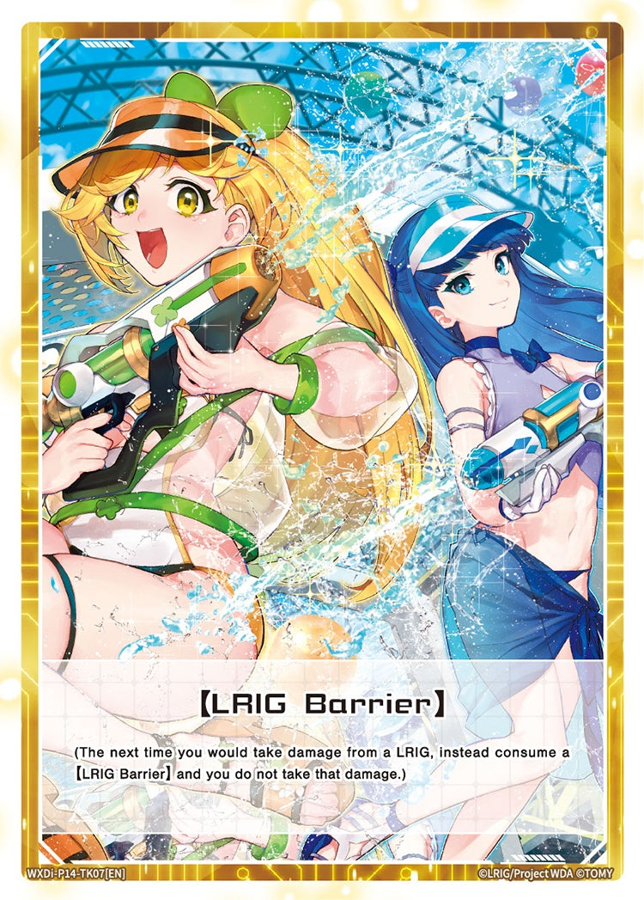

# 【LRIG Barrier】

## Thông tin lá

| Trường | Giá trị |
| --- | --- |
| Mã in | WXDi-P14-TK07[EN] |
| Set | WXDi-P14[EN] |
| Số thứ tự | TK07 |
| Loại thẻ | — |
| Vị trí | Ngoài deck (token/special) |
| Số bản | — (set booster, không áp dụng) |
| Màu | — |
| Độ hiếm | TK,TK(P) |
| Minh họa | — |
| Level | — |
| Limit | — |
| Power | 0 |
| LRIG type / Class | — |
| Team / Master | — |
| Cost | — |
| Grow cost | — |
| Use timing | — |
| Life Burst | Không |

## Card text chính thức

(The next time you would take damage from a LRIG, instead consume a 【LRIG Barrier】and you do not take that damage.)

## Power text / Life Burst

—

## Ghi chú minh họa
Artist: —. Ảnh TK được tải từ Card List tiếng Anh.

Đây là lá token/coin/special đi kèm sản phẩm, không phải lá thường trong bộ chính.

## FAQ chính thức

— (không có FAQ riêng cho mã này trên trang FAQ tiếng Anh.)

## Ảnh biến thể

- [TK](../images/WXDi-P14-TK07P-EN.jpg)

## Nguồn
[Card List/FAQ chính thức](https://www.takaratomy.co.jp/products/en.wixoss/card/card.html?card_no=WXDi-P14-TK07%5BEN%5D ) · [Ảnh thẻ](https://www.takaratomy.co.jp/products/en.wixoss/card/thumb/WXDi-P14-TK07%5BEN%5D.jpg)
