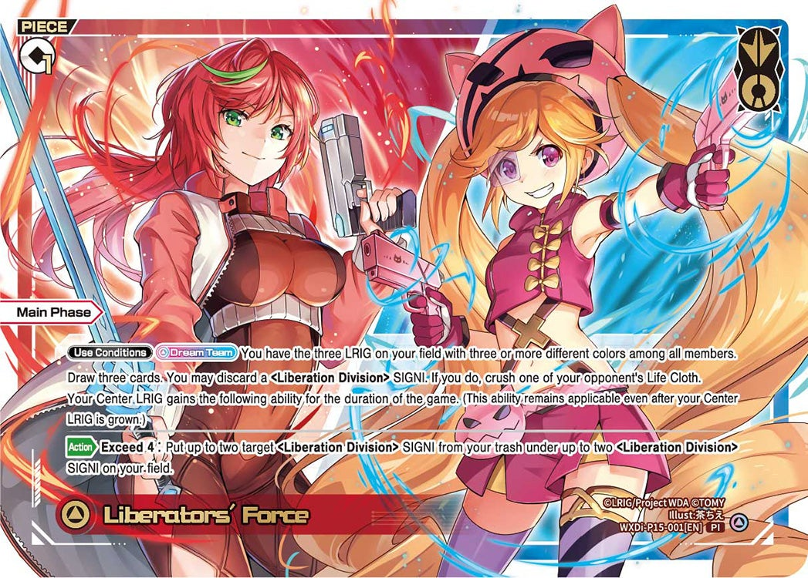

# Liberators' Force

## Thông tin lá

| Trường | Giá trị |
| --- | --- |
| Mã in | WXDi-P15-001[EN] |
| Set | WXDi-P15[EN] |
| Số thứ tự | 001 |
| Loại thẻ | PIECE |
| Vị trí | LRIG Deck |
| Số bản | — (set booster, không áp dụng) |
| Màu | Đỏ / xanh dương |
| Độ hiếm | PI,LRP |
| Minh họa | 茶ちえ |
| Level | — |
| Limit | — |
| Power | 0 |
| LRIG type / Class | — |
| Team / Master | — |
| Cost | 《C》×１ |
| Grow cost | — |
| Use timing | Main Phase |
| Life Burst | Không |

## Card text chính thức

[Use Conditions] [Dream Team] You have the three LRIG on your field with three or more different colors among all members.

Draw three cards. You may discard a <Liberation Division> SIGNI. If you do, crush one of your opponent's Life Cloth.
Your Center LRIG gains the following ability for the duration of the game. (This ability remains applicable even after your Center LRIG is grown.)
『[Action] Exceed 4: Put up to two target <Liberation Division> SIGNI from your trash under up to two <Liberation Division> SIGNI on your field.』

## Power text / Life Burst

—

## Ghi chú minh họa
Artist: 茶ちえ. Ảnh PI được tải từ Card List tiếng Anh.

## FAQ chính thức

**Q. Does the effect after “during this game” occur unless I discard a <Liberation Division> SIGNI from my hand?**
A. No, you do not have to discard to process the effects after “during this game”. The effect that occurs when you discard a <Liberation Division> SIGNI from your hand is only the part that crushes one of your opponent's Life Cloth.

**Q. Does the Exceed ability put two cards underneath one <Liberation Division> SIGNI or one card each on underneath two <Liberation Division> SIGNI?**
A. Yes, it can do either

**Q. What happens if a card is placed underneath a SIGNI and then the SIGNI leaves the field?**
A. Regardless of where the SIGNI moves from the field, any cards placed underneath the SIGNI are put into its owner's trash by Rule-based action.

## Ảnh biến thể

- [LRP](../images/WXDi-P15-001P-EN.jpg)

## Nguồn
[Card List/FAQ chính thức](https://www.takaratomy.co.jp/products/en.wixoss/card/card.html?card_no=WXDi-P15-001%5BEN%5D ) · [Ảnh thẻ](https://www.takaratomy.co.jp/products/en.wixoss/card/thumb/WXDi-P15-001%5BEN%5D.jpg)
