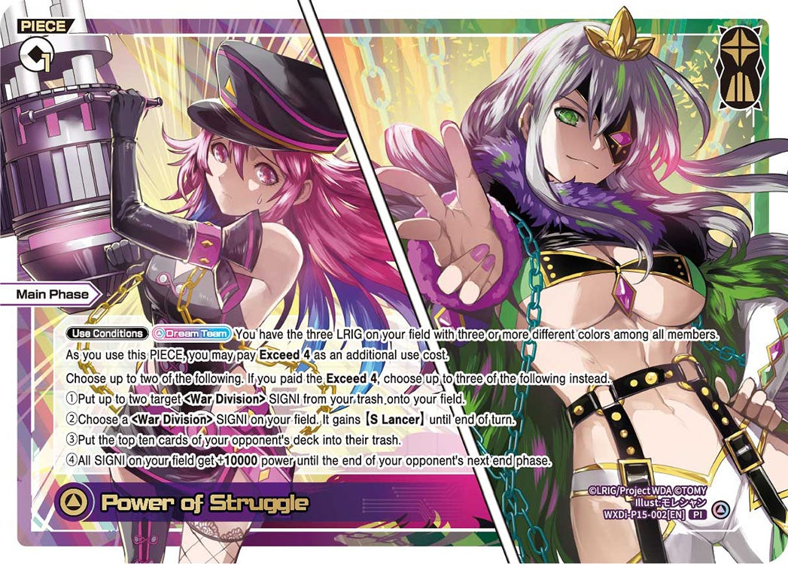

# Power of Struggle

## Thông tin lá

| Trường | Giá trị |
| --- | --- |
| Mã in | WXDi-P15-002[EN] |
| Set | WXDi-P15[EN] |
| Số thứ tự | 002 |
| Loại thẻ | PIECE |
| Vị trí | LRIG Deck |
| Số bản | — (set booster, không áp dụng) |
| Màu | Đen / xanh lá |
| Độ hiếm | PI,LRP |
| Minh họa | モレシャン |
| Level | — |
| Limit | — |
| Power | 0 |
| LRIG type / Class | — |
| Team / Master | — |
| Cost | 《C》×１ |
| Grow cost | — |
| Use timing | Main Phase |
| Life Burst | Không |

## Card text chính thức

[Use Conditions] [Dream Team] You have the three LRIG on your field with three or more different colors among all members.
As you use this PIECE, you may pay Exceed 4 as an additional use cost.

Choose up to two of the following. If you paid the Exceed 4, choose up to three of the following instead.
①Put up to two target <War Division> SIGNI from your trash onto your field.
②Choose a <War Division> SIGNI on your field. It gains 【S Lancer】 until end of turn.
③Put the top ten cards of your opponent's deck into their trash.
④All SIGNI on your field get +10000 power until the end of your opponent's next end phase.

## Power text / Life Burst

—

## Ghi chú minh họa
Artist: モレシャン. Ảnh PI được tải từ Card List tiếng Anh.

## FAQ chính thức

**Q. What kind of ability does [S Lancer] have?**
A. When a SIGNI with [S Lancer] vanishes an opponent's SIGNI by battle, it crushes an opponent's Life Cloth, and if the opponent has no Life Cloth, it deals damage to the opponent. Even if a SIGNI has more than one [Lancer] or [S Lancer], it can only be triggered once in one battle.

**Q. May I use the same choice of (3) twice, etc.?**
A. No, you cannot. If there is no statement such as “You may choose the same effect multiple times.” the effect of choosing an option does not allow you to choose the same option.

**Q. Does the effect of (4) get +10000 power even if a new SIGNI put onto the field after this PIECE is used?**
A. No, only the SIGNI on your field at the time this effect is processed got +10000 power. The power of the SIGNI that put onto the field later is not changed.

**Q. May I use this PIECE by choosing (1) and (2) and give the SIGNI I put onto the field from my trash in (1) an [S Lancer] in (2)?**
A. Yes, you can. The effect of (2) can actually choose one SIGNI on the field to give [S Lancer] after the stage of processing (2).

## Ảnh biến thể

- [LRP](../images/WXDi-P15-002P-EN.jpg)

## Nguồn
[Card List/FAQ chính thức](https://www.takaratomy.co.jp/products/en.wixoss/card/card.html?card_no=WXDi-P15-002%5BEN%5D ) · [Ảnh thẻ](https://www.takaratomy.co.jp/products/en.wixoss/card/thumb/WXDi-P15-002%5BEN%5D.jpg)
