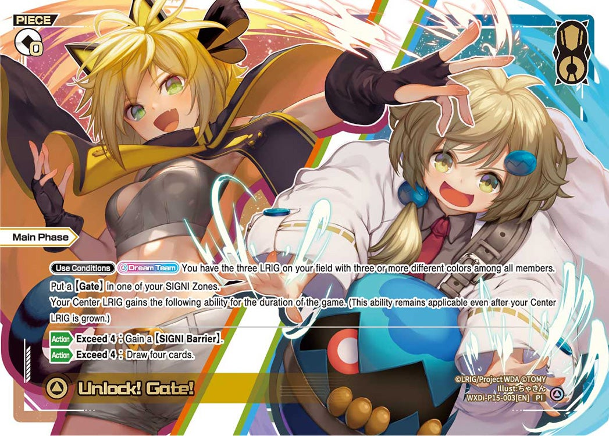

# Unlock! Gate!

## Thông tin lá

| Trường | Giá trị |
| --- | --- |
| Mã in | WXDi-P15-003[EN] |
| Set | WXDi-P15[EN] |
| Số thứ tự | 003 |
| Loại thẻ | PIECE |
| Vị trí | LRIG Deck |
| Số bản | — (set booster, không áp dụng) |
| Màu | Trắng / xanh dương |
| Độ hiếm | PI,LRP |
| Minh họa | ちゃきん |
| Level | — |
| Limit | — |
| Power | 0 |
| LRIG type / Class | — |
| Team / Master | — |
| Cost | 《C》×０ |
| Grow cost | — |
| Use timing | Main Phase |
| Life Burst | Không |

## Card text chính thức

[Use Conditions] [Dream Team] You have the three LRIG on your field with three or more different colors among all members.

Put a 【Gate】 in one of your SIGNI Zones.
Your Center LRIG gains the following ability for the duration of the game. (This ability remains applicable even after your Center LRIG is grown.)
『[Action] Exceed 4: Gain a 【SIGNI Barrier】.
[Action] Exceed 4: Draw four cards.』

## Power text / Life Burst

—

## Ghi chú minh họa
Artist: ちゃきん. Ảnh PI được tải từ Card List tiếng Anh.

## FAQ chính thức

**Q. What is [Gate]?**
A. You may put [Gate] in a SIGNI Zone due to the effect of this card. You may put up to one [Gate] per SIGNI Zone. However, the presence or absence of a [Gate] may change the effect of some cards.

**Q. May I put [Virus] where [Gate] is placed?**
A. Yes, they can be placed. Each [Gate] and [Virus] can only be put up one at a time, but they do not interfere with each other.

**Q. What is the [SIGNI Barrier]?**
A. [SIGNI Barrier] can be gained by an effect. When you take damage, if it is from a SIGNI and you have gained [SIGNI Barrier], spend one to prevent that damage.

Not only damage from attacks, but also damage from SIGNI's effects. "Crush your opponent's Life Cloth” is not a damaging effect and cannot be prevented by [SIGNI Barrier].

**Q. May I choose not to consume 【SIGNI Barrier】 when taking damage?**
A. No, you cannot. If you take damage, you must consume it. However, if there are other effects that prevent you from taking damage (such as Enter ability of 《Bang =Da Capo=》), you can choose which one prevents you from doing so.

**Q. May I prevent the damage from the attack of a SIGNI with [Double Crush] with one [SIGNI Barrier]?**
A. Yes, it can. [Double Crush] is an effect that increases the number of cards you can crush when you deal damage by attacking to two, but still only deals damage once. [SIGNI Barrier] can prevent that one time.

**Q. May my opponent's SIGNI with 【S Lancer】 be prevented by 【SIGNI Barrier】?**
A. If you have no Life Cloth, the effect of 【S Lancer】 causing damage can be prevented by 【SIGNI Barrier】. If you have Life Cloth, 【S Lancer】 cannot be prevented because its effect is to crush your Life Cloth as well as 【Lancer】.

## Ảnh biến thể

- [LRP](../images/WXDi-P15-003P-EN.jpg)

## Nguồn
[Card List/FAQ chính thức](https://www.takaratomy.co.jp/products/en.wixoss/card/card.html?card_no=WXDi-P15-003%5BEN%5D ) · [Ảnh thẻ](https://www.takaratomy.co.jp/products/en.wixoss/card/thumb/WXDi-P15-003%5BEN%5D.jpg)
