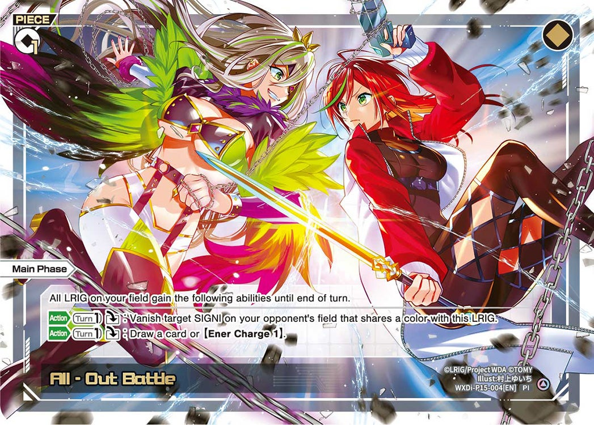

# All - Out Battle

## Thông tin lá

| Trường | Giá trị |
| --- | --- |
| Mã in | WXDi-P15-004[EN] |
| Set | WXDi-P15[EN] |
| Số thứ tự | 004 |
| Loại thẻ | PIECE |
| Vị trí | LRIG Deck |
| Số bản | — (set booster, không áp dụng) |
| Màu | Không màu |
| Độ hiếm | PI,LRP |
| Minh họa | 村上ゆいち |
| Level | — |
| Limit | — |
| Power | 0 |
| LRIG type / Class | — |
| Team / Master | — |
| Cost | 《C》×１ |
| Grow cost | — |
| Use timing | Main Phase |
| Life Burst | Không |

## Card text chính thức

All LRIG on your field gain the following abilities until end of turn.
『[Action] {1/Turn} {Down}: Vanish target SIGNI on your opponent's field that shares a color with this LRIG.
[Action] {1/Turn} {Down}: Draw a card or 【Ener Charge 1】.』

## Power text / Life Burst

—

## Ghi chú minh họa
Artist: 村上ゆいち. Ảnh PI được tải từ Card List tiếng Anh.

## FAQ chính thức

**Q. After using this PIECE, the assist LRIG grows. Does the assist LRIG gain the ability after the grow?**
A. No. If you grow after using this PIECE, you will lose the ability you had gained by this PIECE.

## Ảnh biến thể

- [LRP](../images/WXDi-P15-004P-EN.jpg)

## Nguồn
[Card List/FAQ chính thức](https://www.takaratomy.co.jp/products/en.wixoss/card/card.html?card_no=WXDi-P15-004%5BEN%5D ) · [Ảnh thẻ](https://www.takaratomy.co.jp/products/en.wixoss/card/thumb/WXDi-P15-004%5BEN%5D.jpg)
