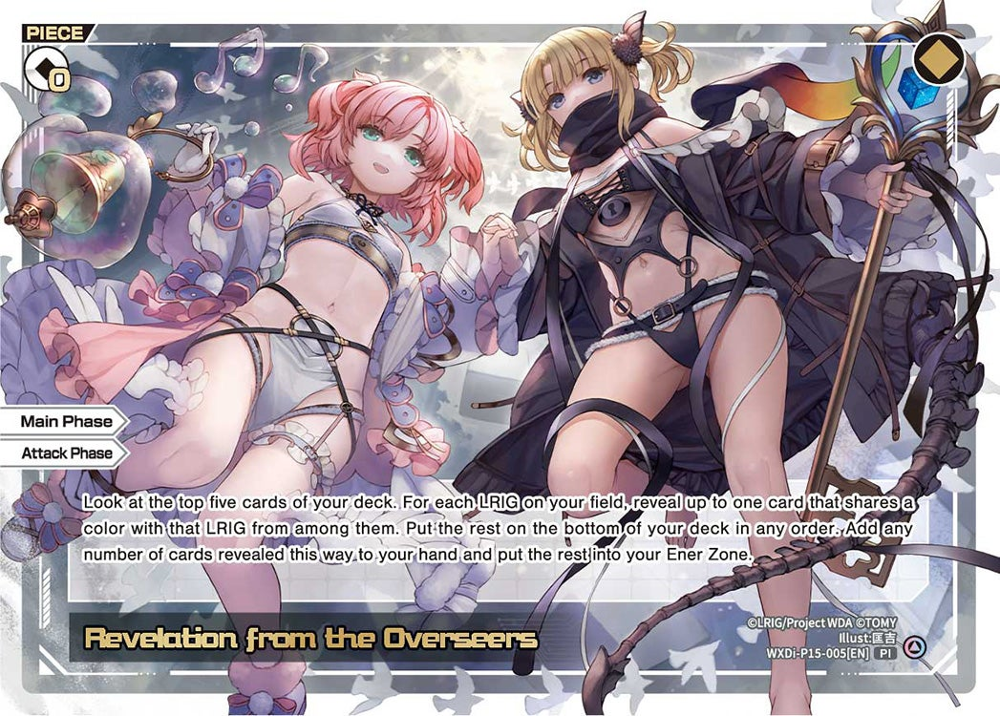

# Revelation from the Overseers

## Thông tin lá

| Trường | Giá trị |
| --- | --- |
| Mã in | WXDi-P15-005[EN] |
| Set | WXDi-P15[EN] |
| Số thứ tự | 005 |
| Loại thẻ | PIECE |
| Vị trí | LRIG Deck |
| Số bản | — (set booster, không áp dụng) |
| Màu | Không màu |
| Độ hiếm | PI,LRP |
| Minh họa | 匡吉 |
| Level | — |
| Limit | — |
| Power | 0 |
| LRIG type / Class | — |
| Team / Master | — |
| Cost | 《C》×０ |
| Grow cost | — |
| Use timing | Main Phase
Attack Phase |
| Life Burst | Không |

## Card text chính thức

Look at the top five cards of your deck. For each LRIG on your field, reveal up to one card that shares a color with that LRIG from among them. Put the rest on the bottom of your deck in any order. Add any number of cards revealed this way to your hand and put the rest into your Ener Zone.

## Power text / Life Burst

—

## Ghi chú minh họa
Artist: 匡吉. Ảnh PI được tải từ Card List tiếng Anh.

## FAQ chính thức

**Q. If the center LRIG and two assist LRIG are all white, may this effect reveal three white cards?**
A. Yes, you can.

**Q. May I reveal 《Servant #》 with this effect?**
A. No, it cannot. 《Servant #》 has [Multi Ener], but [Multi Ener] does not change the color of the card itself.
Colorless has no color, so even if your LRIG is colorless, it that not share a color and cannot be revealed by this effect.

## Ảnh biến thể

- [LRP](../images/WXDi-P15-005P-EN.jpg)

## Nguồn
[Card List/FAQ chính thức](https://www.takaratomy.co.jp/products/en.wixoss/card/card.html?card_no=WXDi-P15-005%5BEN%5D ) · [Ảnh thẻ](https://www.takaratomy.co.jp/products/en.wixoss/card/thumb/WXDi-P15-005%5BEN%5D.jpg)
