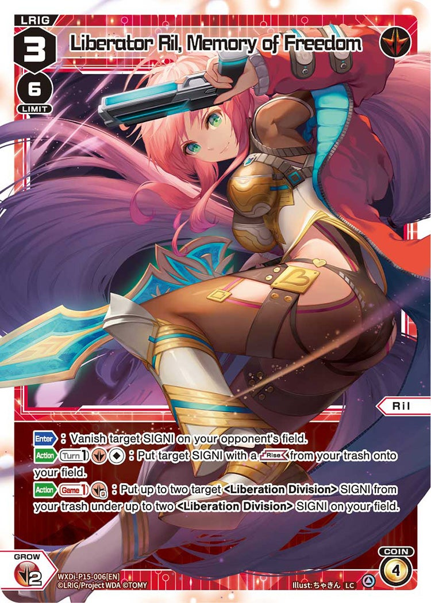

# Liberator Ril, Memory of Freedom

## Thông tin lá

| Trường | Giá trị |
| --- | --- |
| Mã in | WXDi-P15-006[EN] |
| Set | WXDi-P15[EN] |
| Số thứ tự | 006 |
| Loại thẻ | LRIG |
| Vị trí | LRIG Deck |
| Số bản | — (set booster, không áp dụng) |
| Màu | Đỏ |
| Độ hiếm | LC,LR,LRP,UR |
| Minh họa | ちゃきん |
| Level | 3 |
| Limit | 6 |
| Power | 0 |
| LRIG type / Class | Ril |
| Team / Master | — |
| Cost | — |
| Grow cost | 《R》×２ |
| Use timing | — |
| Life Burst | Không |

## Card text chính thức

[Enter]: Vanish target SIGNI on your opponent's field.
[Action] {1/Turn} {Red} {Colorless}: Put target SIGNI with a {Rise Icon} from your trash onto your field.
[Action] {1/Game} {Redx0}: Put up to two target <Liberation Division> SIGNI from your trash under up to two <Liberation Division> SIGNI on your field.

## Power text / Life Burst

—

## Ghi chú minh họa
Artist: ちゃきん. Ảnh LC được tải từ Card List tiếng Anh.

## FAQ chính thức

**Q. Do I need to meet the Rise condition when I use the first [Action] ability to put SIGNI with a [Rise] onto the field?**
A. Yes, even if it is put onto the field by an effect, it cannot be put onto the field unless the Rise condition is met.

**Q. What happens if a card is placed underneath a SIGNI and then the SIGNI leaves the field?**
A. Regardless of where the SIGNI moves from the field, any cards placed underneath the SIGNI are put into its owner's trash by Rule-based action.

**Q. May the second [Action] ability put two cards underneath one <Liberation Division> SIGNI or one card each on underneath two <Liberation Division> SIGNI?**
A. Yes, you can do either.

## Ảnh biến thể

- [LRP](../images/WXDi-P15-006P-EN.jpg)
- [LR](../images/WXDi-P15-006R-EN.jpg)
- [UR](../images/WXDi-P15-006U-EN.jpg)

## Nguồn
[Card List/FAQ chính thức](https://www.takaratomy.co.jp/products/en.wixoss/card/card.html?card_no=WXDi-P15-006%5BEN%5D ) · [Ảnh thẻ](https://www.takaratomy.co.jp/products/en.wixoss/card/thumb/WXDi-P15-006%5BEN%5D.jpg)
