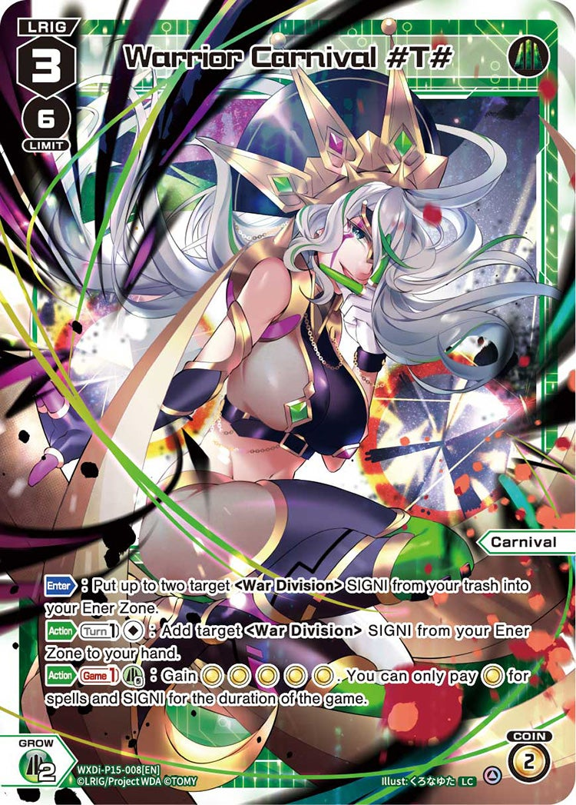

# Warrior Carnival #T#

## Thông tin lá

| Trường | Giá trị |
| --- | --- |
| Mã in | WXDi-P15-008[EN] |
| Set | WXDi-P15[EN] |
| Số thứ tự | 008 |
| Loại thẻ | LRIG |
| Vị trí | LRIG Deck |
| Số bản | — (set booster, không áp dụng) |
| Màu | Xanh lá |
| Độ hiếm | LC,LR,LRP,UR |
| Minh họa | くろなゆた |
| Level | 3 |
| Limit | 6 |
| Power | 0 |
| LRIG type / Class | Carnival |
| Team / Master | — |
| Cost | — |
| Grow cost | 《G》×２ |
| Use timing | 2 |
| Life Burst | Không |

## Card text chính thức

[Enter]: Put up to two target <War Division> SIGNI from your trash into your Ener Zone.
[Action] {1/Turn} {Colorless}: Add target <War Division> SIGNI from your Ener Zone to your hand.
[Action] {1/Game} {Greenx0}: Gain {Coin Icon} {Coin Icon} {Coin Icon} {Coin Icon} {Coin Icon}. You can only pay {Coin Icon} for spells and SIGNI for the duration of the game.

## Power text / Life Burst

—

## Ghi chú minh họa
Artist: くろなゆた. Ảnh LC được tải từ Card List tiếng Anh.

## FAQ chính thức

**Q. What happens if I use the second [Action] ability when I already have the coin?**
A. The maximum number of coins is five, so no matter how many coins you have, it will be five.

**Q. If a spell with bet, like 《Battlespear》, may I pay for it with the coins I gain from the first [Action] ability?**
A. Yes, the spell's bet is an additional cost of the spell and can be paid with the coins gained from this [Action] ability.

## Ảnh biến thể

- [LRP](../images/WXDi-P15-008P-EN.jpg)
- [LR](../images/WXDi-P15-008R-EN.jpg)
- [UR](../images/WXDi-P15-008U-EN.jpg)

## Nguồn
[Card List/FAQ chính thức](https://www.takaratomy.co.jp/products/en.wixoss/card/card.html?card_no=WXDi-P15-008%5BEN%5D ) · [Ảnh thẻ](https://www.takaratomy.co.jp/products/en.wixoss/card/thumb/WXDi-P15-008%5BEN%5D.jpg)
