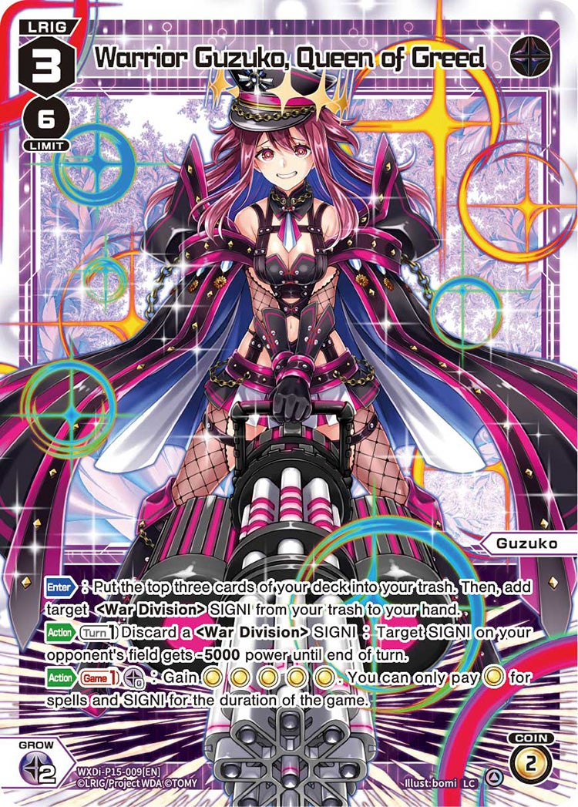

# Warrior Guzuko, Queen of Greed

## Thông tin lá

| Trường | Giá trị |
| --- | --- |
| Mã in | WXDi-P15-009[EN] |
| Set | WXDi-P15[EN] |
| Số thứ tự | 009 |
| Loại thẻ | LRIG |
| Vị trí | LRIG Deck |
| Số bản | — (set booster, không áp dụng) |
| Màu | Đen |
| Độ hiếm | LC,LR,LRP,UR |
| Minh họa | bomi |
| Level | 3 |
| Limit | 6 |
| Power | 0 |
| LRIG type / Class | Guzuko |
| Team / Master | — |
| Cost | — |
| Grow cost | 《B》×２ |
| Use timing | 2 |
| Life Burst | Không |

## Card text chính thức

[Enter]: Put the top three cards of your deck into your trash. Then, add target <War Division> SIGNI from your trash to your hand.
[Action] {1/Turn} Discard a <War Division> SIGNI: Target SIGNI on your opponent's field gets -5000 power until end of turn.
[Action] {1/Game} {Blackx0}: Gain {Coin Icon} {Coin Icon} {Coin Icon} {Coin Icon} {Coin Icon}. You can only pay {Coin Icon} for spells and SIGNI for the duration of the game.

## Power text / Life Burst

—

## Ghi chú minh họa
Artist: bomi. Ảnh LC được tải từ Card List tiếng Anh.

## FAQ chính thức

**Q. What happens if I use the second [Action] ability when I already have the coin?**
A. The maximum number of coins is five, so no matter how many coins you have, it will be five.

**Q. If a spell with bet, like 《Battlespear》, may I pay for it with the coins I gain from the first [Action] ability?**
A. Yes, the spell's bet is an additional cost of the spell and can be paid with the coins gained from this [Action] ability.

**Q. In the [Enter] ability, may I target SIGNI from the three I put the top three cards of my deck into their owner's trash?**
A. Yes, you can. If you target after the “then” in the text, you do not target at the time of trigger, but rather after you have finished the process up to before the “then” and then target it when the process actually comes to that text.

## Ảnh biến thể

- [LRP](../images/WXDi-P15-009P-EN.jpg)
- [LR](../images/WXDi-P15-009R-EN.jpg)
- [UR](../images/WXDi-P15-009U-EN.jpg)

## Nguồn
[Card List/FAQ chính thức](https://www.takaratomy.co.jp/products/en.wixoss/card/card.html?card_no=WXDi-P15-009%5BEN%5D ) · [Ảnh thẻ](https://www.takaratomy.co.jp/products/en.wixoss/card/thumb/WXDi-P15-009%5BEN%5D.jpg)
