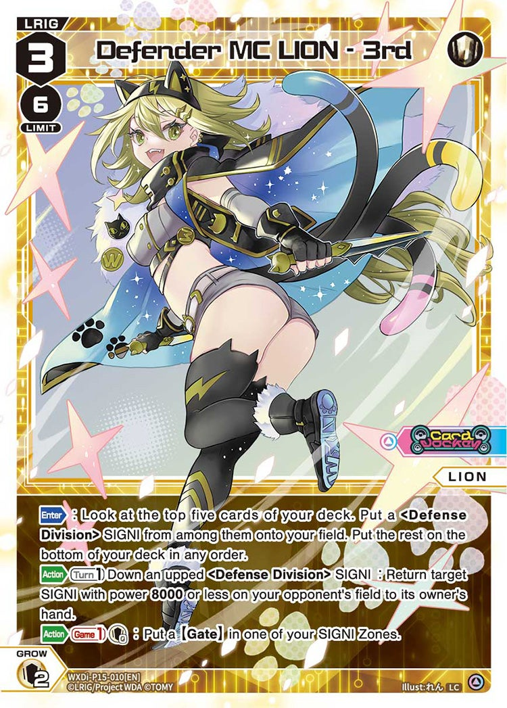

# Defender MC LION - 3rd

## Thông tin lá

| Trường | Giá trị |
| --- | --- |
| Mã in | WXDi-P15-010[EN] |
| Set | WXDi-P15[EN] |
| Số thứ tự | 010 |
| Loại thẻ | LRIG |
| Vị trí | LRIG Deck |
| Số bản | — (set booster, không áp dụng) |
| Màu | Trắng |
| Độ hiếm | LC,LR,LRP,UR |
| Minh họa | れん |
| Level | 3 |
| Limit | 6 |
| Power | 0 |
| LRIG type / Class | LION |
| Team / Master | Card Jockey |
| Cost | — |
| Grow cost | 《W》×２ |
| Use timing | — |
| Life Burst | Không |

## Card text chính thức

[Enter]: Look at the top five cards of your deck. Put a <Defense Division> SIGNI from among them onto your field. Put the rest on the bottom of your deck in any order.
[Action] {1/Turn} Down an upped <Defense Division> SIGNI: Return target SIGNI with power 8000 or less on your opponent's field to its owner's hand.
[Action] {1/Game} {Whitex0}: Put a 【Gate】 in one of your SIGNI Zones.

## Power text / Life Burst

—

## Ghi chú minh họa
Artist: れん. Ảnh LC được tải từ Card List tiếng Anh.

## FAQ chính thức

**Q. What is [Gate]?**
A. You may put [Gate] in a SIGNI Zone due to the effect of this card. You may put up to one [Gate] per SIGNI Zone. However, the presence or absence of a [Gate] may change the effect of some cards.

**Q. May I put [Virus] where [Gate] is placed?**
A. Yes, they can be placed. Each [Gate] and [Virus] can only be put up one at a time, but they do not interfere with each other.

## Ảnh biến thể

- [LRP](../images/WXDi-P15-010P-EN.jpg)
- [LR](../images/WXDi-P15-010R-EN.jpg)
- [UR](../images/WXDi-P15-010U-EN.jpg)

## Nguồn
[Card List/FAQ chính thức](https://www.takaratomy.co.jp/products/en.wixoss/card/card.html?card_no=WXDi-P15-010%5BEN%5D ) · [Ảnh thẻ](https://www.takaratomy.co.jp/products/en.wixoss/card/thumb/WXDi-P15-010%5BEN%5D.jpg)
