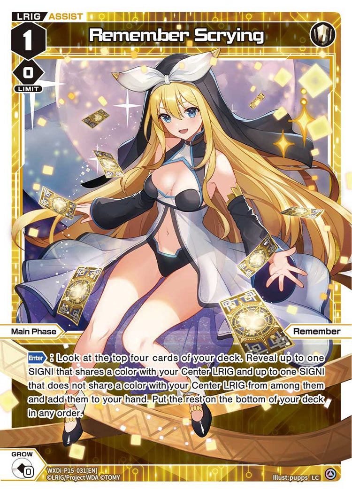

# Remember Scrying

## Thông tin lá

| Trường | Giá trị |
| --- | --- |
| Mã in | WXDi-P15-031[EN] |
| Set | WXDi-P15[EN] |
| Số thứ tự | 031 |
| Loại thẻ | ASSIST LRIG |
| Vị trí | LRIG Deck |
| Số bản | — (set booster, không áp dụng) |
| Màu | Trắng |
| Độ hiếm | LC,LC(P) |
| Minh họa | pupps |
| Level | 1 |
| Limit | 0 |
| Power | 0 |
| LRIG type / Class | Remember |
| Team / Master | — |
| Cost | — |
| Grow cost | 《C》×０ |
| Use timing | Main Phase |
| Life Burst | Không |

## Card text chính thức

[Enter]: Look at the top four cards of your deck. Reveal up to one SIGNI that shares a color with your Center LRIG and up to one SIGNI that does not share a color with your Center LRIG from among them and add them to your hand. Put the rest on the bottom of your deck in any order.

## Power text / Life Burst

—

## Ghi chú minh họa
Artist: pupps. Ảnh LC được tải từ Card List tiếng Anh.

## FAQ chính thức

**Q. May I reveal 《Servant #》 with this effect?**
A. It is possible if it is a SIGNI that does not have a color in common with your center LRIG. 《Servant #》 has [Multi Ener], but [Multi Ener] does not change the color of the card itself. Colorless has no color, so even if your LRIG is colorless, it that not share a color.

## Ảnh biến thể

- [LC(P)](../images/WXDi-P15-031P-EN.jpg)

## Nguồn
[Card List/FAQ chính thức](https://www.takaratomy.co.jp/products/en.wixoss/card/card.html?card_no=WXDi-P15-031%5BEN%5D ) · [Ảnh thẻ](https://www.takaratomy.co.jp/products/en.wixoss/card/thumb/WXDi-P15-031%5BEN%5D.jpg)
