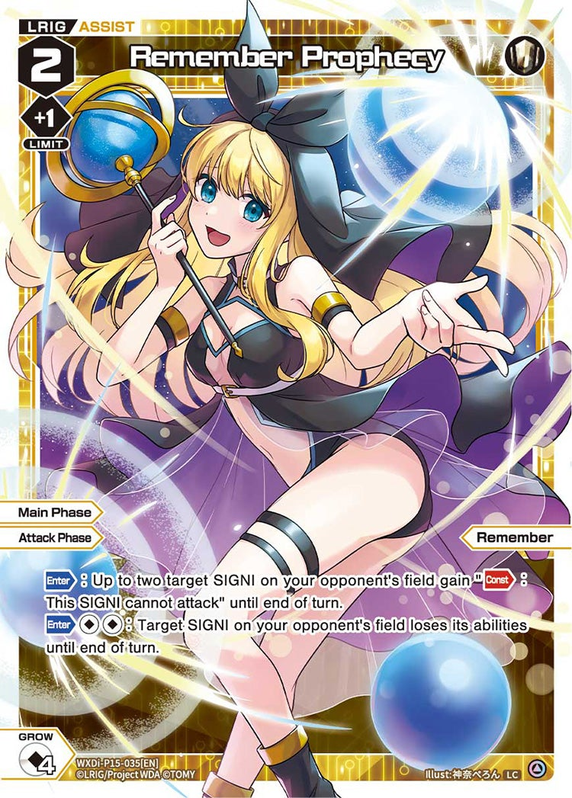

# Remember Prophecy

## Thông tin lá

| Trường | Giá trị |
| --- | --- |
| Mã in | WXDi-P15-035[EN] |
| Set | WXDi-P15[EN] |
| Số thứ tự | 035 |
| Loại thẻ | ASSIST LRIG |
| Vị trí | LRIG Deck |
| Số bản | — (set booster, không áp dụng) |
| Màu | Trắng |
| Độ hiếm | LC,LC(P) |
| Minh họa | 神奈ぺろん |
| Level | 2 |
| Limit | 1 |
| Power | 0 |
| LRIG type / Class | Remember |
| Team / Master | — |
| Cost | — |
| Grow cost | 《C》×４ |
| Use timing | Main Phase / Attack Phase |
| Life Burst | Không |

## Card text chính thức

[Enter]: Up to two target SIGNI on your opponent's field gain "[Constant]: This SIGNI cannot attack" until end of turn.
[Enter] {Colorless} {Colorless}: Target SIGNI on your opponent's field loses its abilities until end of turn.

## Power text / Life Burst

—

## Ghi chú minh họa
Artist: 神奈ぺろん. Ảnh LC được tải từ Card List tiếng Anh.

## FAQ chính thức

**Q. May I trigger the second [Enter] ability first and then the first [Enter] ability?**
A. Yes, you can trigger multiple [Enter] abilities in any order you wish. For example, even if SGINI like 《Lalaru//Memoria, Code: Art》 has the ability “This SIGNI cannot gain new abilities by your opponent's effects.”, you can make it lose the ability with the second [Enter] ability first, and then use the first [Enter] ability to gain “[Const]: This SIGNI cannot attack.”.

## Ảnh biến thể

- [LC(P)](../images/WXDi-P15-035P-EN.jpg)

## Nguồn
[Card List/FAQ chính thức](https://www.takaratomy.co.jp/products/en.wixoss/card/card.html?card_no=WXDi-P15-035%5BEN%5D ) · [Ảnh thẻ](https://www.takaratomy.co.jp/products/en.wixoss/card/thumb/WXDi-P15-035%5BEN%5D.jpg)
