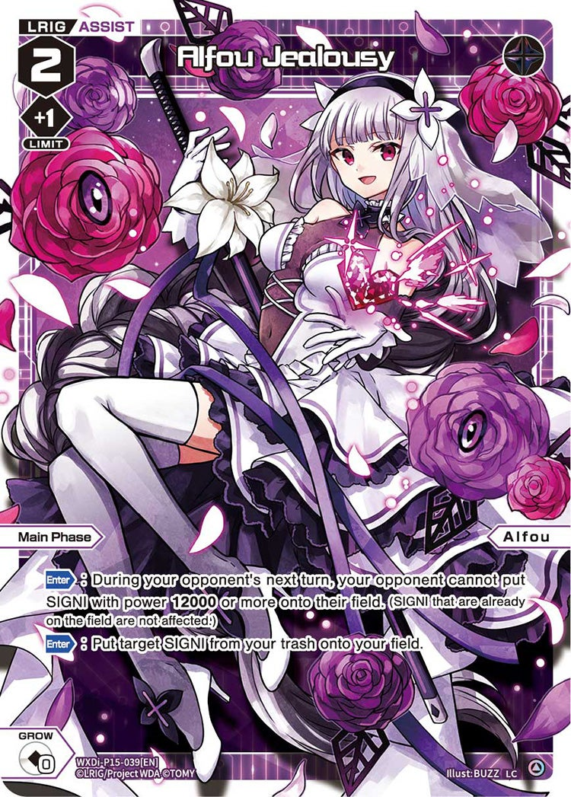

# Alfou Jealousy

## Thông tin lá

| Trường | Giá trị |
| --- | --- |
| Mã in | WXDi-P15-039[EN] |
| Set | WXDi-P15[EN] |
| Số thứ tự | 039 |
| Loại thẻ | ASSIST LRIG |
| Vị trí | LRIG Deck |
| Số bản | — (set booster, không áp dụng) |
| Màu | Đen |
| Độ hiếm | LC,LC(P) |
| Minh họa | BUZZ |
| Level | 2 |
| Limit | 1 |
| Power | 0 |
| LRIG type / Class | Alfou |
| Team / Master | — |
| Cost | — |
| Grow cost | 《C》×０ |
| Use timing | Main Phase |
| Life Burst | Không |

## Card text chính thức

[Enter]: During your opponent's next turn, your opponent cannot put SIGNI with power 12000 or more onto their field. (SIGNI that are already on the field are not affected.)
[Enter]: Put target SIGNI from your trash onto your field.

## Power text / Life Burst

—

## Ghi chú minh họa
Artist: BUZZ. Ảnh LC được tải từ Card List tiếng Anh.

## FAQ chính thức

**Q. After resolving the first [Enter] ability, what happens if SIGNI on my opponent's field gets power plus modifier and becomes 12000 or more?**
A. In that case, the SIGNI remains on the field. This effect is only limited to new SIGNI from outside the field.

**Q. After resolving the first [Enter] ability, there is my opponent's Center LRIG is 《Hirana, a Step Towards the Glimmer》 and “During your turn, SIGNI in your center SIGNI Zone get +3000 power.”. May my opponent put SIGNI with 10000 power into the center SIGNI zone?**
A. Yes, your opponent can put it into the center SIGNI zone. Even if the power of the card becomes more than 12000 after put it, it can be put if it is not more than 12000 when it is in the hand before put it.

## Ảnh biến thể

- [LC(P)](../images/WXDi-P15-039P-EN.jpg)

## Nguồn
[Card List/FAQ chính thức](https://www.takaratomy.co.jp/products/en.wixoss/card/card.html?card_no=WXDi-P15-039%5BEN%5D ) · [Ảnh thẻ](https://www.takaratomy.co.jp/products/en.wixoss/card/thumb/WXDi-P15-039%5BEN%5D.jpg)
