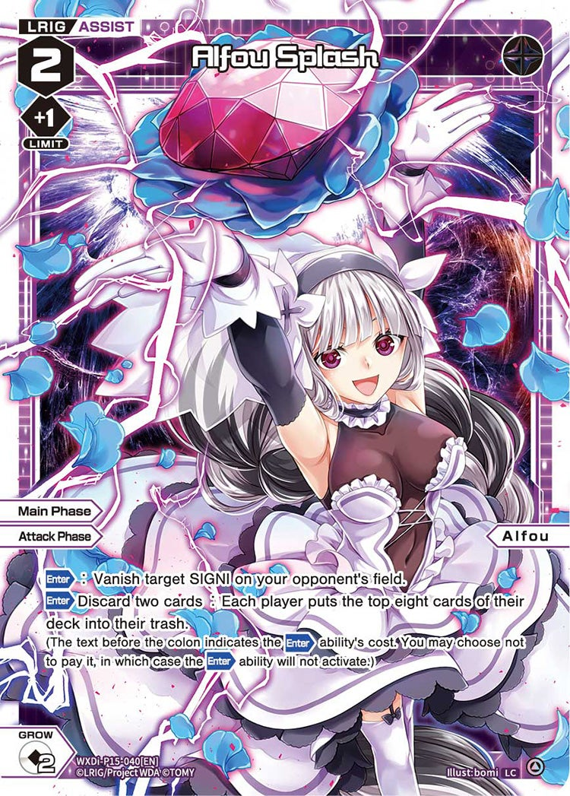

# Alfou Splash

## Thông tin lá

| Trường | Giá trị |
| --- | --- |
| Mã in | WXDi-P15-040[EN] |
| Set | WXDi-P15[EN] |
| Số thứ tự | 040 |
| Loại thẻ | ASSIST LRIG |
| Vị trí | LRIG Deck |
| Số bản | — (set booster, không áp dụng) |
| Màu | Đen |
| Độ hiếm | LC,LC(P) |
| Minh họa | bomi |
| Level | 2 |
| Limit | 1 |
| Power | 0 |
| LRIG type / Class | Alfou |
| Team / Master | — |
| Cost | — |
| Grow cost | 《C》×２ |
| Use timing | Main Phase
Attack Phase |
| Life Burst | Không |

## Card text chính thức

[Enter]: Vanish target SIGNI on your opponent's field.
[Enter] Discard two cards: Each player puts the top eight cards of their deck into their trash.
(The text before the colon indicates the [Enter] ability's cost. You may choose not to pay it, in which case the [Enter] ability will not activate.)

## Power text / Life Burst

—

## Ghi chú minh họa
Artist: bomi. Ảnh LC được tải từ Card List tiếng Anh.

## FAQ chính thức

**Q. What happens if a player has seven or less cards in their deck and triggers the second [Enter] ability?**
A. In that case, the player puts all cards of the deck into their owner's trash, and if the player has more than eight cards of the deck, they puts eight cards of the deck into their owner's trash. The player with no deck then refreshes it.

## Ảnh biến thể

- [LC(P)](../images/WXDi-P15-040P-EN.jpg)

## Nguồn
[Card List/FAQ chính thức](https://www.takaratomy.co.jp/products/en.wixoss/card/card.html?card_no=WXDi-P15-040%5BEN%5D ) · [Ảnh thẻ](https://www.takaratomy.co.jp/products/en.wixoss/card/thumb/WXDi-P15-040%5BEN%5D.jpg)
